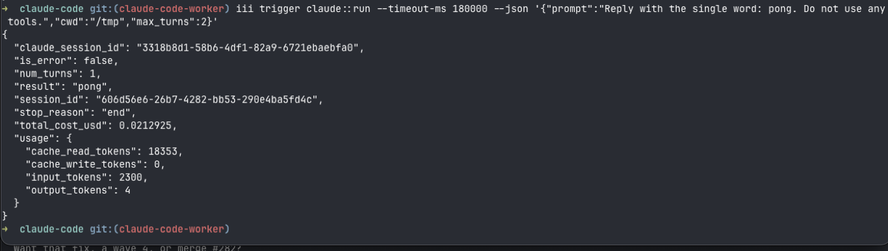
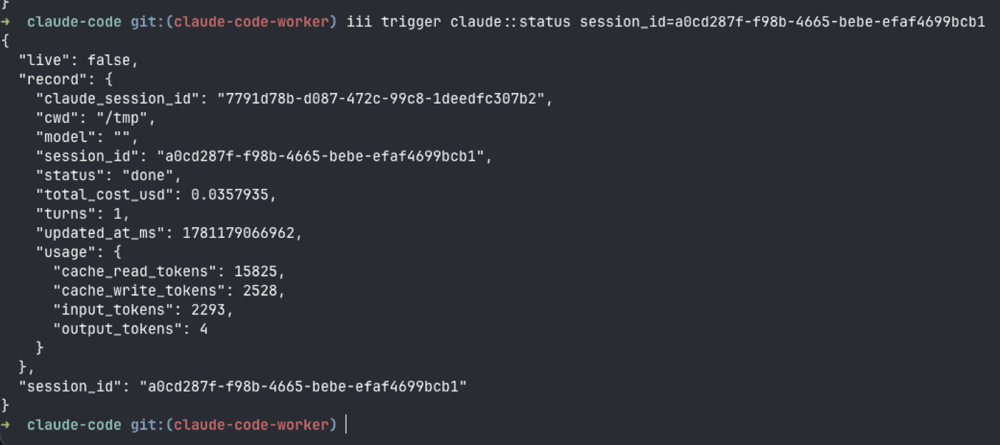
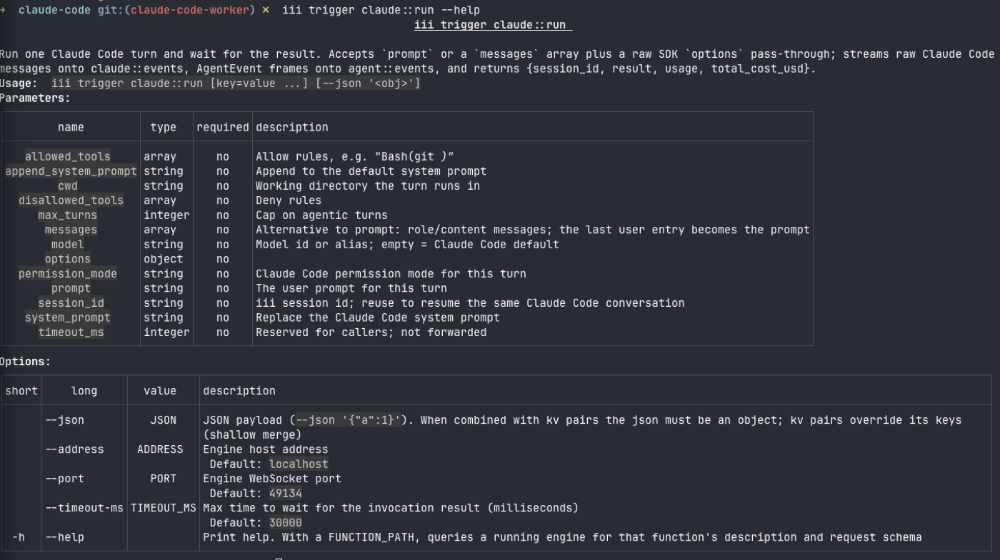
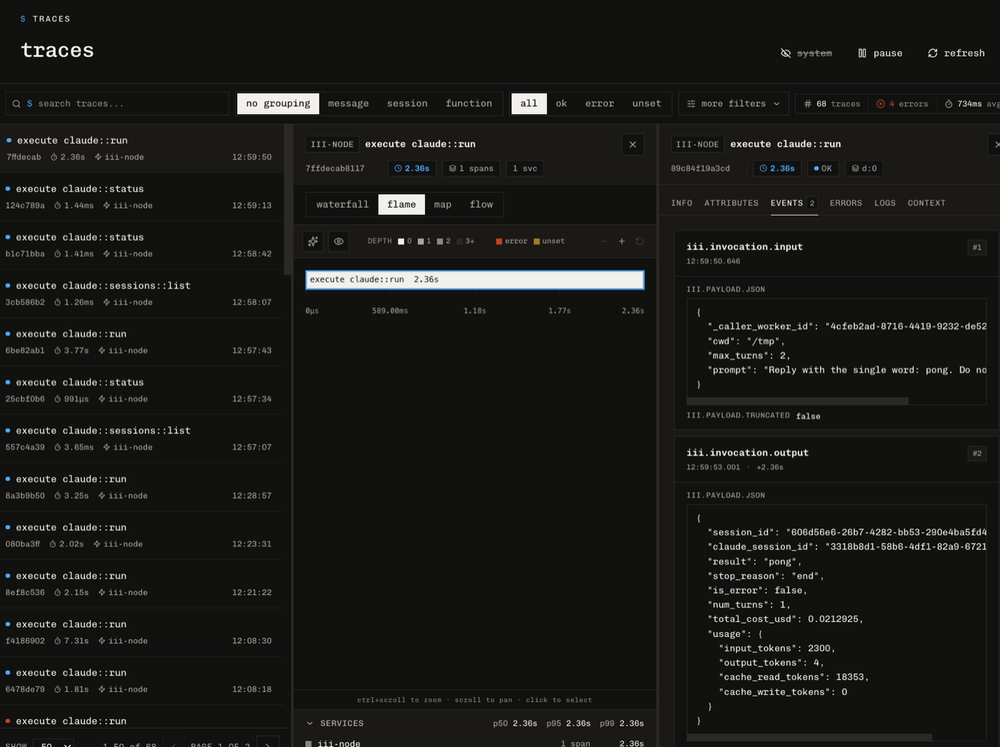

# claude-code

Claude Code as an iii worker: the Claude Code API exposed as functions on the iii bus, nothing else. The worker spawns the same `claude` binary the user runs in their terminal, with the same login, the same filesystem, and the same tools (file edits, shell, web). `claude::run` executes one headless turn and returns the result; the raw Claude Code messages are published verbatim on the `claude::on-raw-event` function, and a translated AgentEvent view on `claude::on-agent-event`, so the iii console, the acp worker, and any sibling worker observe a Claude Code run exactly like a native harness turn. The acp worker drives it with `--brain-fn claude::run`.

The same worker also runs Claude Code as a **terminal on the console**: `claude::terminal::*` installs the CLI on the terminal host, equips a workspace with the iii skills, and opens Claude in a `shell::pty` session on its own page — always Claude, never a shell. Both halves report onto one feed, `claude::on-agent-event`, so a headless turn and a typed turn look the same in the console. Whether they also share one login depends on where each half runs: from a local checkout both are host processes and read the same `~/.claude`, while a worker installed from the registry runs the headless half in a microVM that cannot (see [Logging in](#logging-in)). Its sibling [`pi`](https://github.com/iii-hq/workers/tree/main/pi) is the same shape for the pi agent.

## Install

```bash
iii call compose::add worker=claude-code
```

Requires the `claude` CLI on the host (the Agent SDK shells out to it) and either `ANTHROPIC_API_KEY` in the worker environment or an existing `claude` login.

The terminal half adds three companions:

| Worker | Why |
|---|---|
| [`ide`](https://github.com/iii-hq/workers/tree/main/ide) | Owns the terminal through its `shell::*` functions: `shell::pty::open` runs the CLI, `shell::exec` installs it and equips the workspace, `coder::read-file` reads the files back. The workspace must be inside its jail (`fs.host_roots`). |
| [`ade`](https://github.com/iii-hq/workers/tree/main/ade) | Renders the injected **claude** page. |
| `configuration` (built in) | Holds the settings below. |

## Skills

Install the `claude-code` agent skill for Claude Code, Cursor, and 30+ other agents:

```bash
npx skills add iii-hq/workers --skill claude-code
```

## Quickstart

From zero to a Claude Code turn over the bus:

```bash
curl -fsSL https://install.iii.dev/iii/main/install.sh | sh
iii call compose::add worker=claude-code
iii   # starts the engine + worker
```

Then talk to it like any other function: from the console chat, from `iii call claude::run`, or from any SDK:

```ts
import { registerWorker } from 'iii-sdk';

const iii = registerWorker('ws://127.0.0.1:49134', { workerName: 'demo' });

const res = await iii.call({
  function_id: 'claude::run',
  payload: {
    prompt: 'Add a /health endpoint to server.ts and run the tests',
    cwd: '/path/to/repo',
    permission_mode: 'acceptEdits',
  },
  timeoutMs: 600_000,
});
// { session_id, claude_session_id, result, stop_reason, usage, total_cost_usd }
```

Or straight from the terminal with the `iii call` CLI:

```bash
# one full turn (raise the timeout; the default 30s is too short for agent turns)
iii call claude::run --timeout-ms 600000 \
  --json '{"prompt":"add a /health endpoint and run the tests","cwd":"/path/to/repo"}'

# quick reads use key=value syntax
iii call claude::sessions::list
iii call claude::status session_id=<session_id>

# background turn + control
iii call claude::start --json '{"prompt":"...","cwd":"/path/to/repo"}'
iii call claude::stop session_id=<session_id>

# ask the running engine for a function's description
iii call claude::run --help
```

A turn from the CLI and the session record it leaves behind:







Call `claude::run` again with the returned `session_id` to continue the same conversation: the worker maps iii session ids to Claude Code session ids in engine state and resumes automatically. A turn that would run beside another on the same conversation is refused with `busy: true` and a `reason` (and `started: false` from `claude::start` and `claude::task`): while a run of that session is live here, or while another process on the terminal host, such as a terminal, has the conversation open. `options.forkSession: true` continues in a copy.

Two ids come back from every run. `session_id` is the iii session id: the key for `claude::status`, `claude::stop`, resume, and the `session_id` an event-feed observer passes as its args. `claude_session_id` is Claude Code's internal session id (what the worker passes to the CLI's resume under the hood) — returned for reference, not a lookup key.

Long turns: use `claude::start` to return immediately, then observe `claude::on-agent-event` with args `{ session_id }` (see [Event feeds](#event-feeds)) for `message_complete`, `function_execution_start/end`, and `turn_end` frames. `claude::stop` interrupts a live run, `claude::status` reads a point-in-time view, `claude::sessions::list` enumerates past sessions.

## Functions

| Function | Purpose |
| --- | --- |
| `claude::run` | Run one turn, wait, return the final result and its `turn_id` |
| `claude::start` | Fire-and-forget turn; returns `session_id` and `turn_id` at once, progress arrives on `claude::on-agent-event`, the end in `claude_turns` (see [Waiting for a turn to finish](#waiting-for-a-turn-to-finish)) |
| `claude::task` | Delegate one task as a SUB-AGENT: hand it off with a call or an observer, get the session id back at once, pass `parent_session_id` to nest it under the session that delegated it, and be woken by its settle in `claude_turns` (see [Waiting for a turn to finish](#waiting-for-a-turn-to-finish)). The outcome is also written to `agent_tasks/<session id>`, the shape every agent worker shares, but only by the run itself: a worker restart settles `claude_turns` alone |
| `claude::stop` | Interrupt a live run |
| `claude::status` | Session state, live flag, usage, cost |
| `claude::sessions::list` | All sessions this worker has run |
| `claude::agents::list` | Every Claude Code session in one list: this worker's headless runs plus the terminal host's interactive and background sessions (see [Listing sessions](#listing-sessions)) |
| `claude::agents::stop` | Stop a live background session of the terminal host (`claude stop`); its conversation is kept. Only with `external_sessions` on. A headless run stops through `claude::stop` |
| `claude::terminal::describe` | What a terminal session runs: program, argv, cwd, env — the page passes it straight to `shell::pty::open` — plus `activity_bridge` and `detail`, which say whether the hooks can reach the bus. With `session` (a row id of `claude::agents::list`), the argv and cwd that open that session, and `copy: true` when they open a copy of it. Internal. |
| `claude::terminal::activity` | One Claude Code hook event in, AgentEvent frames out. Internal, and `trace_hidden` — the signal is the feed, not the delivery. |
| `claude::auth::status` | Which plan a terminal session spends (see [Billing](#billing-which-plan-a-session-spends)). Agent-denied. |
| `claude::ui-content` | Console page assets. Internal. |

`claude::run` accepts either a bare `prompt` string or a `messages` array (`[{ role: 'user', content: [{ type: 'text', text }] }]`), plus `model`, `cwd`, `system_prompt`, `append_system_prompt`, `permission_mode`, `allowed_tools`, `disallowed_tools`, and `max_turns` overrides, and an optional `turn_id` (non-empty, at most 200 characters; minted when omitted) that names the turn in its settle.

### Raw API pass-through

The named fields above cover the common path; everything else the Agent SDK accepts goes through the `options` field untouched (camelCase, exactly as in the SDK):

```jsonc
{
  "prompt": "...",
  "options": {
    "forkSession": true,
    "includePartialMessages": true,
    "fallbackModel": "claude-sonnet-4-6",
    "addDirs": ["/another/repo"]
  }
}
```

And the full output side is available raw: every message Claude Code emits (`system/init`, `assistant`, `user`, `result`, and `stream_event` token deltas when `includePartialMessages` is set) is published verbatim on `claude::on-raw-event`. Consumers that want the exact Claude Code wire format observe `claude::on-raw-event`; consumers that want harness-shaped frames observe `claude::on-agent-event`. Same turn, two views.

## Event feeds

The worker hosts two event feeds and publishes every turn on them (headless
runs, `claude::task` sub-agents, and the console terminal). Both are private functions: only this worker calls them, and anyone
may observe them.

| Function | Args | Delivery | `event` carries |
| --- | --- | --- | --- |
| `claude::on-agent-event` | `{ session_id }` | iii, to the observers of that session | translated AgentEvent frames (`message_complete`, `function_execution_start/end`, `turn_end`, `agent_end`) |
| `claude::on-raw-event` | `{ session_id }` | iii, to the observers of that session | every Claude Code message verbatim (`system/init`, `assistant`, `user`, `result`, `stream_event`) |

`session_id` is required, non-empty and at most 512 characters; the engine
rejects any other arg with `INVALID_ARGS`. Each feed accepts up to 256
observers; one more is rejected with `OBSERVER_LIMIT`. A frame of a session
nobody observes is not sent.

```ts
iii.observe(
  { function_id: 'claude::on-agent-event', args: { session_id }, capture: ['output'] },
  'my::on-claude-event',
  { metadata: { team: 'a' } }, // optional: handed to your function as the metadata sidecar
);
```

With `capture: ['output']` your function receives one call per frame,
fire-and-forget: the `Observed` envelope, whose `output` is the frame:

```jsonc
{
  "session_id": "sess_...",
  "event_id": "sess_...-<epoch>-00000007", // dedup key
  "seq": 7,              // contiguous per (feed, session_id, epoch), from 0
  "epoch": "<uuid>",     // changes when the worker restarts; seq restarts at 0
  "source": "claude",
  "event": { "type": "message_complete", "message": { } }
}
```

Deliveries are not guaranteed to arrive in order: order by `(epoch, seq)` and
drop duplicates by `event_id`. The two feeds number their frames
independently, and `seq` advances for every frame, observed or not. The feeds
are ephemeral: nothing is stored or replayed, and an observer added after a
frame was published never sees it. The durable history is the session record
(`claude::status`, `claude::sessions::list`), the turn's return value, and the
session-manager transcript (`session::messages`) the console renders. A
consumer that fails or disappears never fails the turn.

The feeds do not use iii-stream (see the guide "Migrate from iii-stream and
pubsub"). The acp worker observes `claude::on-agent-event` for the brain
`claude::run`.

## Waiting for a turn to finish

Every turn this worker sees end writes one record to state scope
`claude_turns`: headless turns (`claude::run`, `claude::start`,
`claude::task`) under their `session_id`, and any session that loads the iii
plugin (the console terminal) under its Claude Code session id, from the
plugin's `Stop` and `SessionEnd` activity hooks (`claude::terminal::activity`
also settles a `StopFailure`, the event Claude Code sends instead of `Stop`
when a turn ends on an API error, once the published plugin reports it).
Observe `state::on-changed` once and be woken by it; no polling.

```jsonc
{
  "id": "sess_...",            // iii session_id, or the Claude Code session id for a hook session
  "source": "run",             // run | hook | boot (a restart settled a turn left running)
  "status": "completed",       // completed | stopped | error | gone (the session ended)
  "turn_id": "my-turn-1",
  "claude_session_id": "...",
  "stop_reason": "end",
  "result": "final assistant text, when known",
  "error": "set when status is error",
  "background_tasks": 0,       // Stop hook: >0 means paused on background work, not finished
  "settled_at_ms": 1764000000000
}
```

Choose the `session_id` and the `turn_id` yourself, register the observer
BEFORE starting the turn, and pass both: an id you leave out is minted, and
the observer never fires. The `turn_id` keeps a settle of an earlier turn on
the same session from waking you:

```ts
iii.registerFunction('my::on-claude-turn', ({ output: event }) => {
  // event.new_value is the settle above
});
await iii
  .observe(
    {
      function_id: 'state::on-changed',
      filters: {
        'input.scope': { $eq: 'claude_turns' },
        'input.key': { $eq: session_id },
        'input.new_value.turn_id': { $eq: turn_id },
      },
      capture: ['output'],
    },
    'my::on-claude-turn',
  )
  .ready();
await iii.call({ function_id: 'claude::start', payload: { session_id, turn_id, prompt } });
```

The settle is written after the session's final status and after its run
slot is released, so the woken observer can call `claude::start` on the same
session at once. For a terminal session, use the Claude Code session id as
the key and no `turn_id` filter. `claude::terminal::activity` accepts any
caller, so confirm a settle before acting on it. A headless one:
`claude::status` shows `live: false` and `record.status` `done` or `error`. A
terminal one has no `claude_sessions` record, so use `claude::agents::list`:
the row whose `id` is that Claude Code session id is `idle` or `done`, or for
`gone` is missing or not `alive`, in a response with no `detail`.

## Listing sessions

`claude::agents::list` (`{ all?: boolean }`) returns `{ agents, detail? }`,
one row per session:

- `headless`: a `claude::run` / `claude::start` / `claude::task` session of
  this worker, from `claude_sessions`, newest first (`updated_at_ms`). `busy`
  while its run is live, then `done`, `error`, or `stopped` after
  `claude::stop`; `unknown` when the record says `working` and no run is live
  here.
- `interactive` and `background`: sessions on the terminal host, read from its
  `claude agents --json` (`--all` adds completed background sessions). The
  CLI's states map to `busy`, `idle`, `waiting` (with `waiting_for`), `done`,
  `error` and `stopped`; anything else is `unknown`. `alive` is true while a
  process runs the session. A headless run's own CLI row is dropped, unless the
  run is open in a terminal: a process runs its Claude session and no turn runs
  here. Then the CLI row is listed (whatever `external_sessions` says) and the
  headless row is dropped, because a message would put a second writer on the
  conversation. A background row carries its `short_id` only with
  `external_sessions` on: it is what `claude::agents::stop` needs.
  `pty_session_id` names the console terminal (`shell::pty`) that runs the
  session, when one does.

That output has no versioned contract, so a value this worker does not know
reads as `unknown`, and a failed or unreadable listing leaves only the
headless rows, with the reason in `detail`. By default a host session is
listed only when this worker saw it (its hooks reached
`claude::terminal::activity`) or it runs in a console terminal; the others are
counted in `detail`. Set `external_sessions: true` to list every session on
that host.

`claude::agents::stop` (`{ id }`, the Claude Code session id) stops one
background session by the short id a fresh listing gives it. It refuses, with a
`reason`, when `external_sessions` is off, when no live background session has
that id, and for interactive sessions, which nothing here can stop.

The console's **claude** page shows this list in a rail beside the terminal:
the sessions open in this console, the others on the host, of which a live
background one can be stopped, and the worker's own runs, which take a message
(`claude::start`) or a stop (`claude::stop`). It re-reads when a turn starts or settles (`claude_sessions`
and `claude_turns` in state), when a hooked terminal reports a session start, a
prompt, a stop or an end, when the terminal beside it changes session, when the
window gains focus, and on its refresh button.

A click on a row opens that session in the terminal, in its own directory. One
that runs in a terminal of this console shows that terminal; a finished run
resumes (`claude --resume`); a background session is attached to (`claude
attach`, which needs `external_sessions` on). A session that is live anywhere
else, in another terminal or in a headless turn, opens as a copy under a new id
(`--fork-session`), after a confirmation: the CLI would let a second process
resume the same id, and both would write to one transcript. Nothing is
resumed while `claude agents --json` fails, since then nothing says whether a
session is live.

### Reading a terminal session’s replies

Enable `external_sessions: true` only if callers may read assistant reply text on the terminal host. Use the full `claude_session_id` of an interactive or background row, even if idle. Neither API opens the session or needs a Stop hook. A headless-only row, a worker session alias, a CLI short ID or a conversation absent from `claude agents --json --all` is not a lookup key.

```typescript
const { last_reply, status } = await iii.call({
  function_id: 'claude::agents::get', payload: { claude_session_id },
});
// last_reply is { id, text }, or null if the active branch has no assistant text.
iii.registerFunction('consumer::on-reply', ({ output }) => handleReply(output.reply));
const watch = iii.observe({
  function_id: 'claude::agents::on-reply', args: { claude_session_id }, capture: ['output'],
}, 'consumer::on-reply');
await watch.ready(); // a readable transcript was required for admission
```

`invalid Claude session id`, `session not listed` and `inventory unavailable` distinguish a bad key, a successful inventory miss and a failed listing. `transcript unavailable` is an error, **not** `last_reply: null`. The terminal host needs POSIX directory-relative file access and Python 3 on PATH. The reader looks only in `projects/<project>/<UUID>.jsonl` under `CLAUDE_CONFIG_DIR` (default `~/.claude`). The projects root may point to a shared store; descendant links, ambiguous matches, unreadable files and unsupported or broken parent chains are refused. Unknown record layouts, compacted chains that require relinking and content-replacement records are not supported. Limits per read: 4,096 project entries, 8 MiB per file, 65,536 complete records, 1 MiB per record, 48 KiB of encoded output and five seconds. Only newline-complete records count. The last reply follows the latest non-sidechain conversation back through its parents; user messages, tool use/results, thinking and abandoned branches are not replies.

The watch argument is `{ claude_session_id: string }` (a full UUID). Admission rejects with `OBSERVER_LIMIT` at 256 watches, including pending admissions. A closed gate or failed baseline rejects with `OBSERVE_REJECTED`; an invalid argument can be rejected by the engine as `INVALID_ARGS`. Targets receive the call fields they capture: with `capture: ['output']`, `output` contains `{ claude_session_id, reply: { id, text } }`. The worker dispatches directly to the matching observer while permission is current; its private poller receives no result.

Each watch starts at its **own** successful baseline; it does not send the current answer. Lookup and subscribe are not atomic: an answer between them can be missed. Polling is best effort, not a durable feed. Only newly appended replies still on the active branch at a successful poll are delivered. Failed reads leave the cursor unchanged; replacement, truncation or prefix changes establish a new baseline without replay. A closed or uncertain live setting pauses watches; renewed permission takes a fresh baseline. Worker restarts, branch switches, permission changes, limits and delivery failures can leave gaps. Use the reply’s record ID, not its text, to deduplicate. Dispose the watch when finished.

## The agent on the bus

By default every turn's system prompt carries the iii runtime context: the same engine-grounded rules as the harness identity prompts, retargeted to the `iii` CLI the agent reaches through its shell. The agent discovers capabilities from the live engine instead of memory — `iii call engine::functions::list` to find function ids, `iii call <fn> --help` as the contract before every first call, the registry flow (`directory::registry::workers::list/info`, `compose::add`) when nothing registered fits — plus the calling rules and error-handling discipline that go with them. The matching `Bash(iii *)` allow rule is added automatically so those calls run headless. Local file edits stay on Claude Code's native tools; backend actions go through registered functions.

When the engine runs [`mcp-server`](../mcp-server/README.md), a turn gets the `default-mcp` profile and the `iii` MCP tools instead, and this CLI text is left out: it says to act only through the `iii` CLI, which contradicts default-mcp's `iii_call`.

```bash
# the agent answers this by querying the live engine itself
iii call claude::run --timeout-ms 300000 \
  --json '{"prompt":"List every worker connected to this engine and what each one does.","cwd":"/tmp"}'
```

Turn it off per call with `"iii_context": false` or globally in `config.yaml`; a caller-supplied `system_prompt` always wins verbatim and gets nothing appended.

## Plan mode and permission modes

`permission_mode` maps straight onto Claude Code's native modes, per turn:

| Mode | Behavior |
| --- | --- |
| `default` | Claude Code's standard permission prompts (headless: unapproved calls fail) |
| `acceptEdits` | File edits auto-approved; the worker default |
| `plan` | Native plan mode: read-only exploration, produces a plan, refuses edits |
| `bypassPermissions` | Skip all permission checks |

Plan mode headless behaves like plan mode in the terminal: the turn ends when Claude finishes the plan, and the plan text is the `result` — nothing executes. Because the worker resumes sessions, plan-then-execute is two calls against the same `session_id`:

```bash
# 1. plan (read-only)
iii call claude::run --timeout-ms 600000 \
  --json '{"prompt":"Plan how to add rate limiting to the REST API. Do not implement.","cwd":"/path/to/repo","permission_mode":"plan"}'

# 2. execute the plan with full context, same conversation
iii call claude::run --timeout-ms 600000 \
  --json '{"session_id":"<from-step-1>","prompt":"Implement the plan.","permission_mode":"acceptEdits","cwd":"/path/to/repo"}'
```

The approval step is whatever sits between the two calls — a human reading the plan, another worker, or an observer.

## The terminal on the console

A **claude** page appears in the console nav; opening it starts a session. The
first run installs the CLI and the skills, so it takes a minute. Answer the
login prompt in the terminal, then ask Claude to build something on the engine
— the iii plugin (default-mcp and the iii skills) teaches it how to register
functions and observers. Every prompt and tool call it runs is published on
`claude::on-agent-event`, exactly like a `claude::run` turn.

```bash
iii call claude::terminal::describe   # what a session runs, and where
iii call shell::pty::sessions         # what is actually running
iii call claude::status session_id=<session id>   # the session record
iii call session::messages session_id=<session id> # the persisted transcript
```

The page keeps a per-tab lease, so a reload or a pane move reattaches to the
same live Claude rather than starting a second one.

A session outlives the tab that opened it: the reattach lease is stored per
browser, so closing the console and coming back finds the same agent instead
of starting a second one beside it. When the replay would be partial — the
worker's ring buffer is finite and an agent repaints constantly — the page
skips the broken history and asks the agent to paint its current screen (a
one-row resize, which is a SIGWINCH) rather than writing wreckage into the
pane.

The status bar carries a font-size stepper (8–40 px, 14 by default; Ctrl or ⌘
+ scroll does the same). The size is one value for every terminal in the
console — the ide worker's panes included — so it is set once, not per page. The
terminal itself stays dark whatever the console theme is: an agent CLI paints
its own interface in colors chosen for a dark terminal and never learns the
page went light.

### Which folder, and what a session gets

Each Claude pane has its own **folder pill** in its bottom row. A session
starts in the chat's working directory, else in the compose project's folder
(the folder holding the project's worker-compose file, from `compose::list`),
never in the ide worker's own folder. Picking another folder closes the
session and starts a new one there: Claude Code cannot change folder
mid-session. `claude::terminal::describe { cwd?, session? }` is what the page
calls; it prepares the session right then, every time. A session opened from
the Sessions panel (`session`: a `claude::agents::list` row id) is prepared in
that session's own folder, and its resume argv goes after the prepared one.

When `terminal.setup_workspace` is on, that preparation:

- **installs the published `iii` plugin in the folder when it is missing**,
  with Claude Code's own commands: `claude plugin list --json` (run in the
  folder) decides; when `iii@iii` is not installed and enabled for it, the
  worker adds the `iii` marketplace (iii-hq/agent-plugins-claude) if it is
  missing and runs `claude plugin install iii@iii --scope local` there (a
  disabled local install is enabled instead). The plugin is not configured
  and no copy of it is written: no `--plugin-dir`, no generated hooks,
  commands or agent. A folder already covered is left alone.
- **sets the environment of the Claude process**, read at that start:
  `III_MCP_URL` (the http worker's address from `http::status`, plus `/mcp`;
  the plugin's `.mcp.json` reads it), `III_CLI` (the `iii` CLI on the terminal
  host, which the plugin's activity hooks report through to
  `claude::terminal::activity`) and `III_URL`. A moved http worker therefore
  reaches the next session without a worker restart.
- **writes default-mcp** to `<workspace_dir>/default-mcp.md` (the worker's own
  folder on the terminal host) and checks it is there before appending it with
  `--append-system-prompt-file`; a session never starts with a path to a
  missing file. An `--append-system-prompt` in `terminal.args` wins.

Headless `claude::run` turns get the same plugin check in the folder the turn
runs in (its `cwd`, else this worker's own folder), on this worker's host,
and the same `III_MCP_URL` / `III_CLI` environment. A turn reads the folder's
local settings (`settingSources: ['local']`, where a local install lives)
only when the plugin is there.

The `/iii:<profile>` commands and the `iii` agent come from the plugin
itself: its SessionStart hook generates them (`sync`, in the background, so a
profile added to the engine appears from the next session on) and adds the
default-mcp profile to the session.

## Billing: which plan a session spends

The status bar under the terminal says it, and `claude::auth::status` answers
it on the bus:

| Badge | Means |
|---|---|
| `team subscription · you@example.com · org` | A Claude subscription login on the terminal host pays. |
| `API key billing · ANTHROPIC_API_KEY` | An API key pays, per token. |
| `not signed in` | No credentials yet — run `/login` in the terminal. |

The rule has a trap in it, which is why the badge exists: **an API key beats a
subscription login.** With `ANTHROPIC_API_KEY` set, `claude auth status` still
reports `authMethod: claude.ai` (the account IS signed in) while the CLI bills
the key — it says so itself ("ANTHROPIC_API_KEY or another auth source is set
and takes precedence over your claude.ai login") and a bogus key 401s the turn.
So the badge reads `apiKeySource`, not `authMethod`, and the tooltip spells out
that the login is signed in but not billed.

The key is read from the environment of the `ide` worker that runs the
session, so that is where to set or unset it.

**A subscription login needs `USER` in the session environment.** Claude Code
keeps subscription credentials in the OS keychain and finds them by the
current user, and a worker's environment is not the operator's shell — compose
clears it and re-seeds an allowlist from the daemon's own environment, so a
daemon started without `USER` hands every child a blank one. The CLI then
reports `loggedIn: false` beside a keychain that plainly holds the login. This
worker asks the terminal host who it is (`id -un`) and puts `USER`/`LOGNAME`
into every session and into the billing probe, so the answer does not depend
on how the daemon was started.

`claude::auth::status` stays agent-denied in `iii-permissions.yaml`: it carries
the operator's account and organization. The console page reaches it as a
user-initiated call, which is not the agent path.

## Logging in

The simplest flow is the terminal itself: open the page and run `/login` (or
`claude auth login`; `--console` for API billing instead of the subscription).
The credentials land in the home directory of whatever runs the session — the
`ide` worker's — and every later session of this terminal reuses them.

**Who else sees that login depends on how a worker is deployed, not on which
machine it is.** Compose starts a container one of two ways
(`iii-compose/src/lifecycle.rs`):

| Container | Start | Home directory |
|---|---|---|
| `path://…` (local checkout), or a registry worker whose payload is a **binary** (Rust `deploy: binary`, e.g. `ide`) | host process | the host's |
| a registry worker whose payload is a **bundle** (Node `deploy: bundle`, e.g. this worker) | microVM, own rootfs | the guest's |

Only the container's own config directory is shared into a VM (virtiofs), and
compose v1 has no volume field, so a VM-booted worker cannot read the host's
`~/.claude`. Consequences:

- The terminal half is unaffected either way: the CLI runs inside the `ide`
  worker, which is a host process, so the login is the host's and this
  worker's own rootfs never matters.
- The headless half spawns `claude` in **this** worker's container. Run from a
  local checkout it is a host process and shares that same login; installed
  from the registry it is in a microVM and does **not**. Give it credentials
  through the channels a VM has: `environment` / `env_file` on its container
  (`ANTHROPIC_API_KEY`, or a long-lived subscription token from `claude
  setup-token`), or the `auth-credentials` vault over the bus — which is why
  that vault exists, and why `provider-claude-code` reads it instead of the
  file.

### If the worker that owns the terminal is virtualized

The terminal half holds because `ide` is a binary payload and therefore a
host process today. If binary workers get VM-booted too, the terminal keeps
working — the CLI, the workspace, and the login simply move into that guest,
and this worker still reaches them over the bus — but three things change:

- The login belongs to that guest's rootfs. Nothing on the host shares it, and
  it survives restarts only as long as the guest's state does.
- The workspace is inside the guest, so the agent no longer sees the
  operator's checkout unless the guest is given it.
- The activity hooks call the `iii` CLI, which may not exist in that guest.
  The worker probes for it and reports the answer as `activity_bridge` on
  `claude::terminal::describe` (empty = the hooks are installed but mute, and
  `detail` says so). That is the first thing to check if a terminal works
  while nothing arrives on `claude::on-agent-event`.

For a terminal host with no one at the keyboard, the same two options apply:
`claude setup-token` once (needs a browser once, returns a long-lived
subscription token) or `ANTHROPIC_API_KEY`, in the environment the `ide`
worker starts with. Either way the badge says which one won.

## Configuration

```yaml
engine_url: ws://127.0.0.1:49134

defaults:
  model: ""                    # empty = Claude Code default
  permission_mode: acceptEdits # default | acceptEdits | plan | bypassPermissions
  max_turns: 50
  cwd: ""                      # default working directory for runs

approval_gate: false           # route tool permissions through policy::check_permissions
claude_executable: ""          # path to the claude CLI; empty = SDK default resolution
external_sessions: false       # claude::agents::list shows every session on the terminal host, and
                               # allows reading assistant replies and opening/stopping background sessions

terminal:                      # the console terminal page — a DIFFERENT host: the ide worker's
  executable: ""               # path to `claude` there; empty = resolve on PATH there
  args: []                     # extra argv for every terminal session
  workspace_dir: ""            # the worker's own files (default-mcp.md); empty = `claude-code` under the ide worker's root. NOT where sessions run
  auto_install: true           # install Claude Code from https://claude.ai/install.sh when missing
  setup_workspace: true        # install the iii plugin in each session folder when missing; append default-mcp
```

Settings live in the `configuration` worker under the **Claude Code** entry —
edit them in the Console's global Settings modal; they hot-reload, and a change to the
`terminal` block applies to the next session (every session is prepared when it starts).

The event feeds are fixed functions, not settings. The former
`events_stream` / `raw_events_stream` keys are ignored; a stored
configuration that still carries them keeps loading.

With `approval_gate: true` and the harness worker installed, every Claude Code tool call is checked against `policy::check_permissions` before it executes, fail-closed when the gate is unreachable, so the same YAML permission rules and console approval flow that govern native harness turns govern Claude Code.

## Observability

Every `claude::run` is an ordinary traced invocation on the engine: the trace carries the full input payload (prompt, cwd, caller worker id) and the output (result, stop reason, token usage, cost) as span events, with per-function p50/p95/p99 in the console's trace explorer — no extra instrumentation in the worker.



### Turns group like a harness turn

Both halves stamp the identity keys an agent harness stamps, so the trace views
group and label this worker's turns with no knowledge of Claude Code
(`ade/docs/timeline-span-tags.md`):

| Key | Value here |
| --- | --- |
| `iii.session.id` | the iii session — what "group by session" groups on |
| `iii.message.id` | one turn: one headless `claude::run`, or one terminal prompt |
| `iii.tag.kind` | `claude.run` for a headless turn, `claude.terminal.turn` for a typed one |
| `iii.tag.message` | a preview of the prompt |
| `iii.tag.display_name` | `Claude terminal · <prompt>` on the terminal half |

The transport is W3C baggage, so every call a turn makes — and every span those
calls produce in other workers — carries the same keys. A terminal turn reaches
this worker as several separate calls (one per hook), so its identity lives in
those keys rather than in one covering span; a headless turn gets both.

## How it maps

| Claude Code | iii |
| --- | --- |
| SDK `query()` turn | `claude::run` invocation |
| every SDK message, verbatim | `claude::on-raw-event` frame |
| assistant message | `message_complete` frame on `claude::on-agent-event` |
| tool_use / tool_result | `function_execution_start` / `function_execution_end` frames |
| final result | `turn_end` + `agent_end` frames, function return value |
| session resume | engine state scope `claude_sessions`, keyed by iii session_id |
| permission prompt | `canUseTool` -> `policy::check_permissions` (optional) |
| extra capability | another iii worker on the bus (`ide`, `database`, `storage`, ...) |
| interactive CLI session | `shell::pty` session on the injected **claude** console page |
| terminal hook event | `claude::terminal::activity` -> the same `claude::on-agent-event` frames |

## The iii Claude Code plugin

The `iii` Claude Code plugin lives in [iii-hq/agent-plugins-claude](https://github.com/iii-hq/agent-plugins-claude): `/iii:profile`, `/iii:skills` and one `/iii:<profile>` command per visible agent profile, backed by the engine's `mcp-server` worker. The worker installs it with Claude Code's own commands (scope local) in the folder of every session where it is missing (headless `claude::run` turns when `iii_context` is on, terminal sessions when `setup_workspace` is on), and points each Claude process at mcp-server with `III_MCP_URL`. It also works in a standalone `claude` on any machine that can reach an engine:

```sh
claude plugin marketplace add iii-hq/agent-plugins-claude
claude plugin install iii@iii
```

`pnpm run build:iii-plugin` (part of `build`, `build:bundle`, `typecheck`, `test` and `dev`) fetches the latest `main` of that repository (a shallow clone; the build needs network) and copies the modules the worker shares with the plugin's CLI into `src/iii-plugin/shared/`, recording the commit as `PLUGIN_SOURCE` in `src/iii-plugin/source.generated.ts`. The plugin's own files are not embedded. Both outputs are generated and git-ignored: change those modules in the plugin repository. The worker logs the commit at start (`claude-code: iii plugin modules from ... at <sha>`). To build against a local checkout instead (offline, or while changing the plugin), set `III_PLUGIN_SOURCE`:

```sh
III_PLUGIN_SOURCE=/path/to/agent-plugins-claude pnpm run build:iii-plugin
```

A failed fetch fails the build. See the [plugin's README](https://github.com/iii-hq/agent-plugins-claude/tree/main/plugins/iii).
