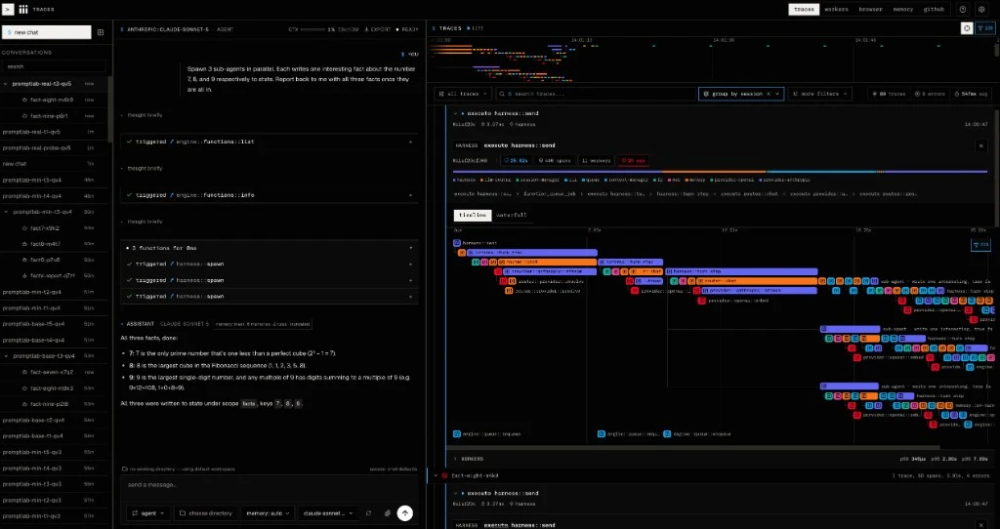

<div align="center">

# harness

**A thin, durable turn loop that turns a model plus a few iii workers into an agent.**

<p>
  <a href="#quickstart"></a>
  <a href="../LICENSE"></a>
  <a href="https://www.rust-lang.org"></a>
  <a href="https://workers.iii.dev/workers/harness"></a>
  <a href="https://workers.iii.dev/workers/ade"></a>
</p>

</div>

`harness` is the thin, durable turn loop that turns a model plus a few iii
workers into an agent. It takes an incoming message, persists it, assembles a
context, streams a completion, runs any function calls the model requests, and
repeats until the turn stops — all as durable, resumable steps so a crash or
restart picks up mid-turn. It wires [`session-manager`](https://github.com/iii-hq/workers/tree/main/session-manager)
(transcript), [`context-manager`](https://github.com/iii-hq/workers/tree/main/context-manager) (token budgeting, soft
dependency), and [`llm-router`](https://github.com/iii-hq/workers/tree/main/llm-router) (generation); install those
alongside it for the full loop.

## Quickstart

Install the engine, export the Anthropic credential in the terminal that will
run the engine, initialize a project, and start it:

```bash
curl -fsSL https://install.iii.dev/iii/main/install.sh | sh
export ANTHROPIC_API_KEY='<your-anthropic-api-key>'
export OPENAI_API_KEY='<your-openai-api-key>'
iii project init iii-app && cd iii-app
iii compose --up
```

```bash
# New terminal, same folder. `compose::add` updates this Compose project.
cd iii-app
iii call compose::add worker=harness worker=ade
```

```bash
open http://localhost:3113
```

Create a session, select **Anthropic → Claude Sonnet 5**, and send your first
message. Then select **OpenAI → GPT-5.6 Luna** in the same chat and send another
message. Create a new chat and send one more message with GPT-5.6 Luna. The
providers read `ANTHROPIC_API_KEY` and `OPENAI_API_KEY` from the engine
environment, so credentials do not need to be pasted into or stored by the
Console.

`iii call compose::add worker=harness` installs every worker the loop needs (see the badges
above); you do not add them one by one. During bootstrap, the harness asks the
`queue` worker to define a dedicated `harness-turn` queue before it reports
ready. That queue is FIFO within each `session_id` and processes separate
sessions concurrently; startup fails if the queue cannot be ensured.

Every turn, sub-agent spawn, and provider call is one correlated trace: the
harness turn waterfall in the console. Failed descendants stamp the whole trace
as failed and carry standard error attributes. The session transcript keeps the
same recovery, partial-output, and blocked-reaction explanation after refresh.
Automatic generation recovery requires partial output from the failed response.
A startup failure with no output ends the turn with a durable failure notice;
it does not consume the partial-response recovery budget.

<p align="center">
  
</p>

The agent-facing function surface is deny-by-default: with no `functions.allow`
globs, every model-requested call is refused and the harness is a plain chat
loop. Allow functions in per-send (`options.functions.allow`) and gate them
with the optional [`approval-gate`](https://github.com/iii-hq/workers/tree/main/approval-gate) sibling.
A pattern is `<namespace>/<pattern>` to match the id only in that namespace, or a bare
`<pattern>` to match the id in every namespace; for example `laptop/shell::*`. A namespace
qualifier must be a plain namespace (no glob characters, and not empty as in `/shell::exec`) and
must be followed by an id pattern that does not start with `/` (`laptop//shell::exec` is
rejected); otherwise the policy is rejected and every call is denied.
A pattern that starts with `hub::` or `peer::` uses a mesh id prefix that no longer exists, and
also rejects the policy: a mesh function keeps its id and lives in the namespace of its machine, so
`peer::laptop::shell::exec` becomes `laptop/shell::exec`, `hub::shell::exec` becomes
`hub/shell::exec`, and `peer::*` becomes one pattern per machine, such as `laptop/*`.
For now a `functions.deny` glob written for a mesh id's old spelling (`laptop::shell::exec`,
`*::shell::pty::*`) still denies the call, and observing it, in another namespace, ahead of every allow; write
`<namespace>/<pattern>`, since a later release drops the old spellings.
A sandbox operation answers as the router's `sandbox::<op>` and as the adapter's own
`<adapter>::<op>` (`sandbox-libkrun`, or the adapter `sandbox::adapter::info` reports). A
`functions.deny` glob or a hook's `functions` glob matching either id covers both;
`functions.allow` stays literal. `sandbox-libkrun` is always covered, a custom adapter's prefix
once a read of `sandbox::adapter::info` succeeds, at startup and on each registry change. If it
fails, for example because RBAC refuses it, the harness logs a warning and the adapter's ids stay
callable until a later read succeeds.

A session whose metadata contains `side_chat_question` is additionally capped by the configured
`side_chat_functions`, regardless of the policy supplied by a later send. Its default ceiling is
`session::get`, `session::messages-tail`, `harness::status`, `kanban::ticket::get`,
`kanban::ticket::list`, `kanban::question::list`, `coder::read-file`, and `memory::recall`.
An explicit `options.functions` may narrow that list but cannot widen it.

Before dispatch, arguments that fail the target's schema are reconciled: stringified JSON the
schema rejects is parsed. When the optional
[`judge`](https://github.com/iii-hq/workers/tree/main/judge) worker is deployed, it also settles
misnamed keys, off-enum values and unknown arguments; it sees the arguments with secret-keyed
values (`password`, `token`, `api_key`, `authorization`, …) masked and long strings cut. Every
repair is noted in the call's result.

The full function reference (every `harness::*` id and its request/response
schema) lives in the code and `iii call engine::workers::info name=harness`.

Building a consumer — a chat UI, a Telegram/WhatsApp bridge, a cron worker, or
any event-driven loop on top of the harness? Start with the integration
contract in
`architecture/integration.md`: the functions to
call, the functions to observe, and the canonical consumer patterns.

## Local development

See [`DEVELOPMENT.md`](DEVELOPMENT.md) to run the Harness and its required
workers from the local source tree with `iii compose`.

## Working with iii

iii is a language agnostic runtime where services, agents, and tools are
composed of the same things: workers, functions, and observers. One engine
holds a live registry of every connected worker, their functions, and the
observers of those functions. Calls route worker to engine to worker, so the
language, runtime, and location of a worker are invisible; the function id is
the only contract.

**1. Discover what is already there (the engine is the source of truth)**
- `engine::functions::list` — every function across all workers (filter with `prefix` / `search` / `worker`)
- `engine::functions::info { function_id }` — the request/response schema for ONE function (this is your API reference)
- `engine::workers::list` / `engine::workers::info { name }` — connected workers and their surface
- `engine::functions::info { function_id }` also gives a function's `args_format` — the args its observers pass
- `engine::observers::list` — every observer that exists

**2. Call a function.** Use `agent_call` with `{ function: "<worker>::<fn>", description: "<short user-facing action>", payload: { ... } }`. The description is shown as the agent's activity in chat; keep it concise and in the session's response language (named in the runtime context, detected from the user's first message). The payload is a JSON object (never a stringified one), and you fetch the contract via `engine::functions::info` before the first call.

**3. Need a capability that is not registered?**
- `directory::registry::workers::list { search: "<capability>" }`
- `directory::registry::workers::info { name }` to judge fit
- choose an operation id and observe `compose::on-operation-progress` with a one-shot wake
  filtered on `{ "input.operation_id": { "$eq": "<operation-id>" }, "input.terminal": { "$eq": true } }`
- call `compose::add { worker: "<name>", operation_id: "<operation-id>" }` with the same id
- read `compose::operation` once for race recovery, then confirm the functions after the terminal event

**4. Worker lifecycle.** `compose::status`, `compose::add`, `compose::up`, `compose::down`, `compose::restart`, `compose::update`, and `compose::remove`. `add`, `update`, and `remove` use the same Compose operation wake flow above; the other operations return their final result directly. `add`, `update`, and `remove` accept a `workers` list for one batch, while their singular `worker` field remains compatible. Fetch their contracts with `compose::schema { function_id: "compose::<operation>" }`. The harness routes `compose::*` to its supervising daemon and scopes each call to its own compose file.

**5. Observers, not polling.** To react to events (HTTP, schedule, webhook, file change), observe the function that emits them: `harness::observe` from a turn, `iii.observe` from a worker. Find the function with `engine::functions::list`, copy its args and filter fields from `engine::functions::info`, and confirm the observer delivers with a real call (e.g. `web::fetch` to its local URL).

**6. Handy workers.**
- `web::fetch` — all HTTP(S); pass `format: "markdown"` to read docs without flooding context
- `coder::*` — file ops for any code task (read/search/create/update/move/delete)
- `slack::*` — post to Slack

**7. Authoring a worker.** Read the SDK reference for your language first (Node / Python / Rust / Browser / Engine WS) at https://iii.dev/docs/reference/. Use the SDK's `registerWorker(...)` and call `iii.registerFunction` / `iii.observe` / `iii.call` on the returned value; they are methods, not top-level exports. Always declare `description`, `request_format`, and `response_format` so the next caller gets a real contract.

TL;DR: list, info, call. The engine tells you the truth; trust it over memory.

## Adding workers with container settings

Fetch `compose::schema { function_id: "compose::add" }` before choosing the payload.
Use container objects only if the running daemon's schema supports them. The singular
`worker` field remains a string shorthand. For settings, use `workers`, which can mix
strings and objects. Put settings inside each object, not at the request's top level.
Only `add` accepts objects; `update` and `remove` take worker names.

After registering the one-shot wake described above, call `compose::add` with a payload
like this (the local worker directory and env file must already exist):

```json
{
  "operation_id": "<operation-id>",
  "workers": [
    "state",
    {
      "worker": "./workers/api",
      "start_after": ["state"],
      "scripts": {
        "pre_run": "pnpm build",
        "pre_run_timeout": "60s",
        "run": "pnpm start",
        "post_run": "echo stopped"
      },
      "config_name": "api",
      "config_override": { "port": 3000 },
      "working_dir": "./workers/api",
      "environment": { "NODE_ENV": "development" },
      "env_file": ["./api.env"],
      "startup_timeout": "30s"
    }
  ]
}
```

`worker` accepts a package name, `name@version`, registry reference, or local directory,
including `package://` and `path://` sources. Objects also accept `version` for packages;
it must agree with any version in `worker`. Omission resolves the latest matching package
version, so keep an explicit version when it must stay pinned.

Use `scripts` (plural); `scripts.run` is valid only for local workers. `start_after`
contains container keys, derived from the last part of each worker name or directory;
required package dependencies are also included. `config_name` selects the base configuration,
and `config_override` supplies values over it. `environment` values must be strings.
`startup_timeout` limits the wait for registration.

Relative `worker`, `working_dir`, and `env_file` paths start at the compose file's directory.
`working_dir` sets the process and hook directory; when omitted, local workers use their own
directory and packages use the compose directory.

For an existing container, omitted settings stay in place. A supplied field replaces that
whole field, including `scripts`, `environment`, and `config_override`; these are not
partial map edits. Use `{}` or `[]` to clear maps or lists. A supplied `start_after` replaces
the list while retaining required package dependencies. Changes can restart running workers.
The acceptance response does not mean ready: finish the same Compose operation wake flow
before using the worker.

## Configuration

The `harness` configuration entry is owned by the `configuration` worker; every
field hot-reloads (no restart). The fields a deployment is most likely to tune:

```yaml
default_max_turns: 16            # per-turn generate-step cap when a send omits it
default_pending_timeout_ms: 1800000  # legacy parked-call (hold / pre-deploy child) wait guard
max_depth: 3                     # sub-agent depth budget
max_children: 8                  # sub-agent spawns-per-turn budget
max_transient_resumes: 3         # recovery generations per turn after retryable provider failures; a turn that still fails reports failure.retryable: true on harness::status
max_result_bytes: 262144         # function-result byte cap at capture; oversized results become an elision marker (0 = off)
prompt_cache_sections: true      # send the frozen profile prefix as its own cacheable section (+ digest) on router::chat
co_author: true                  # tell agents to end git commit messages with "Co-authored-by: iii harness (<model>) <noreply@iii.dev>"
call_reconciliation: judge       # repair malformed call arguments before dispatch: off | coerce (lossless parses) | judge (+ judge::evaluate when deployed)
projects_file_path: ~/.iii/data/harness/projects.json  # chat projects store, harness::projects (default: data/harness-projects.json under III_COMPOSE_DIR / cwd)
folders_file_path: ~/.iii/data/harness/folders.json    # saved-folder catalogue, harness::folders (default: data/harness-folders.json)
descriptions:
  agent_writes: true             # offer harness::set-description to agents (harness::chat-settings::set changes it)
sweep_expression: "0 * * * * *"  # cron for the pending-call expiry sweep
```

Other keys (RPC timeouts, stream coalescing, idempotency TTL, validation
retries) and their defaults live in [`src/config.rs`](src/config.rs).

## Anonymous usage reporting

The harness announces its own usage on the durable `harness:usage` topic. The
engine subscribes to that topic and sends one anonymous product event for each
message. Three moments report:

- `harness_user_turns`, when the user turns (root turns: one user message
  through its final reply) counted across every session in the state store
  reach 1, 2, 5, 10, 25 and 50, then every 50 after that (100, 150, ...). It
  carries `user_turns_total`, `sessions_total`, and `by_model`: user turns per
  provider and model of the root turn, and sessions per provider and model of
  the session's first root turn.
- `harness_model_calls`, on the same milestones of the model calls (assistant
  messages, sub-agents included) counted across every session in the state
  store. Model calls move several at a time, so a report goes out at the
  highest milestone passed. It carries `model_calls_total`, tool call and tool
  call error totals, token totals, `cost_usd`, `user_turns_total`,
  `sessions_total` and `subagents_total`, all across the state store, and
  `by_model`: model calls, tool calls, tokens and cost per provider and model
  that generated them. `subagents_total` counts each sub-agent session one
  time, when it is first seen in its root's session tree.
  `subagent_max_depth` is the deepest sub-agent level that any session tree
  reached. It has no `*_delta`.

Every counter on both events, in total and in each `by_model` entry, has a
matching `*_delta` (for example `tool_calls_delta`, `cost_usd_delta`): the
count since the previous report of the same event. The deltas of one state
store sum to its totals, so they can be added up across stores and time
windows.

- `harness_turn_failed`, once per session for each of the `failed`, `cancelled`
  and `max_turns` outcomes. This keeps the reason a run stopped exact.

`harness_turn_failed` carries the failed turn's model and provider; the two
counting events carry them only inside `by_model`, because their totals span
every model. Beyond those and the counters above, a message carries only a
fixed failure class: no message text, no prompt, no file path and no function
id. Sub-agent turns report nothing of their own; their model calls are
counted through their root session when its turn ends.

- A spawn with only a display parent (`parent_session_id`) is not a root turn.
  Its model calls are counted at the display parent's next root turn. If the
  parent has no further turn, they are not counted.
- A spawn with no parent is a root session, so its turn counts as a user turn.
- A failed turn counts as a user turn. Its `harness_turn_failed` event carries
  `error_kind`; `llm.unknown_model` means the model is not in the router
  catalog, and `llm.unknown` means the failure has no classification.
- A session that an earlier harness release ran takes its usage so far as a
  baseline on its first turn after the upgrade. That usage is not counted again.
- A fork (`session::fork`) takes the history it copied as its baseline, so
  only the model calls the fork makes are counted.
- The usage already counted is kept per session of the tree. When a session is
  deleted from the tree, the model calls of the other sessions are still
  counted.

The reporting keeps its own bookkeeping and only reads the harness's
accounting (`harness::metrics`). The counters live in the `state` worker's
store, so each project counts on its own with the default file-backed `state`
(and an `in_memory` store starts again from zero). The `harness_usage/_machine`
row holds the store-wide counters, updated by compare-and-set. Each
`harness_usage/<session_id>` row records the outcomes a session announced and
the model usage already folded in, per session of its tree, so a turn after a
restart does not count that usage again. A crash after the `_machine` update
and before the session row is saved folds that turn's model usage twice. Each
step is best effort: a failed read or publish is logged at debug level and the
turn continues.

To stop the reports, set `III_TELEMETRY_ENABLED=false` on the engine. The engine
then takes the messages from the topic and discards them, so an opted-out
deployment stores nothing.

## System prompt

The identity prompt is assembled once at send/spawn time. EVERY agent —
top-level turns (`harness::send`) and spawned children alike — is seeded with
the same single identity
([`prompts/default.txt`](prompts/default.txt)): a deliberately minimal prompt
carrying only the basic engine functions and the discovery loop (list, info,
call). A `default` entry in the directory's system-prompt store
(`<skills_folder>/system-prompts/default.md`, served by
`directory::system-prompts::get`) overrides the embedded prompt for every new
composition — write it with `directory::system-prompts::create { name:
"default" }` the first time and `::update` after (or edit the file directly; no
console surface authors it) and the next send picks that up, no restart;
any store failure (directory absent, entry missing, blank body) falls back to
the embedded prompt. What makes a child a leaf is its POLICY, not its prompt: children are
capability-walled out of the orchestration surface (`harness::spawn`,
`harness::send`, `harness::unobserve`) unless spawned with
`options: { orchestrator: true }`; spawn `options.system_prompt` remains the
identity escape hatch.

A spawn may also give its child a display-only identity with
`display: { name, icon?, color? }`. `name` is trimmed, cut to its first 48
characters when longer (never refused for its length), and becomes the title of a newly created child session; `icon` and `color` are
closed semantic tokens recorded with the child linkage in
`metadata.subagent_display`. These fields never affect routing or execution,
and reusing an existing `session_id` retains that session's original title and
metadata. Icons are `agent`, `code`, `search`, `terminal`, `database`, `test`,
`review`, `docs`, or `design`; colors are `neutral`, `blue`, `purple`, `teal`,
`green`, `amber`, or `rose`.

No prompt prescribes an orchestration process — identity prompts carry tool
guidance only, enforced repo-wide by [`tests/prompts.rs`](tests/prompts.rs).
The opt-in fan-out playbook (parent-owned control plane: pick a medium, arm
notifications, spawn leaves directly, define completion per medium) lives in
[`skills/orchestration.md`](skills/orchestration.md) — paste it into a task
prompt or pass it via `options.system_prompt`.

A non-empty `options.system_prompt` is combined with the built-in
prompt per `options.system_prompt_strategy`: `enrich` (default) appends it to
the built-in prompt, while `override` uses it verbatim. Assembly is tested in
[`src/prompt/tests.rs`](src/prompt/tests.rs).

The resolved prompt is STICKY per session, like `model`/`provider` and the
dispatch policy: a send to an existing session that names neither
`system_prompt` nor `system_prompt_strategy` inherits the prior turn's
resolved prompt verbatim (a prior `disabled` turn's absent prompt inherits
too). Naming either field resolves fresh — an explicit bare
`system_prompt_strategy` (e.g. `"enrich"`) is the reset-to-default escape
hatch. The inherited string is frozen at its original resolution — resend
the prompt fields to re-resolve.

Reasoning is sticky the same way: a send that names neither
`thinking_level` nor `provider_options` keeps the prior turn's pair, so an
omitted field never silently resets the effort (which would also bust the
provider's messages cache). Naming either field replaces the pair —
`provider_options: {}` resets to the provider default.

`options.reasoning: "lowest"` asks the harness to choose the effort instead:
the first entry other than `none` in the model's `reasoning_efforts`, else
`minimal` for a model that only reports `supports_thinking`, else no effort
(the provider decides). It cannot be combined with `thinking_level` or
`provider_options`, fails the send when the router has no catalog row for
the model, and the send response reports the choice as `reasoning`
(`thinking_level` and the native `reasoning_effort`). Later sends inherit it
like any explicit effort.

The prompt reaches `router::chat` in two forms: the flat `system_prompt`,
and `system_sections` — the STABLE prefix (the frozen profile or identity
prompt plus the frozen skills index, `cache_boundary: true`) followed by the
per-session tail (session id, working directory, policy aid, and whatever
context assembly and hooks append). Two sessions on the same profile send
the same stable bytes, and `cache_intent.surface_digest` (`sha256:` of that
section) names them, so cache-aware providers can keep one prefix entry for
all of them — when the provider supports it and the prefix meets its minimum
cacheable size: Anthropic puts its cache marker on the boundary block, OpenAI
and Codex derive `prompt_cache_key` from the digest. The digest is a local
identity, never evidence of a hit — `usage.cache_read` is. `harness::status`
reports it as `context.prompt_surface_digest`, or
`context.prompt_sections_fallback` when no sections went out: `disabled`
(`prompt_cache_sections: false`), `no_stable_prefix`, or `prefix_rewritten`
(a `pre_generate` hook replaced the prompt head — the hook's prompt still
wins, it just shares nothing).

### Agent profiles

`options.agent` on a session-creating `harness::send` names a directory agent
profile (`directory::agents::*`, one markdown file per profile). The harness
resolves it ONCE via `directory::agents::get` and freezes the result onto the
turn: the profile's RESOLVED system prompt — the directory composes `extends`
chains root-first, so `tech-lead` extending the bundled `iii` base arrives as
the full iii doctrine followed by the tech-lead body — IS the session
identity. Nothing built-in sits underneath it and no prefix is added; the
usual per-step runtime context (session id, working directory, response language, policy aid,
skills index, hook injections) follows it. A profile whose `extends` chain does not resolve is refused as an
invalid request with the directory's D415 text. The profile's `skills` are
PRELOADED: each id's body is fetched once from `directory::skills::get` and
frozen into a `<preloaded_skills>` block of `<skill id="…">` sections
appended to the prompt (ids the directory cannot serve are named as
unavailable), so the skill is in context on the first step; the session's
skills index is never narrowed by a profile — only an explicit
`options.skills` does that. A profile with `skills_index: false` (inherited
through `extends`) starts its sessions, and children running as it, with no
skills index at all; such a session ignores `options.skills` on its opening
send and refuses it later. Its preloaded skills still render, and
`directory::skills::get` stays callable when the policy allows it. Its
`model` and optional provider-native `reasoning_effort` are authoritative for
the session, and — when the send also omits
`options.functions` — the dispatch policy defaults to the configured
`default_functions` baseline instead of deny-all (an identity picked to DO
something must be able to dispatch). When the profile declares (or
inherits) `functions` — its PRELOADED functions, engine function ids it uses
routinely — the harness renders each one's current description and
compacted request schema into a `<preloaded_functions>` block appended to the
frozen prompt (contracts come from the cached registry snapshot, with one
`engine::functions::info` batch for ids the snapshot cannot vouch for; ids
the engine does not know are named as unavailable), so the model calls them
on the first step instead of spending a search and a contract lookup per
session. The `<preloaded_functions>` block comes first, `<preloaded_skills>`
after it. The frozen block is never rewritten (it is the shared cache
prefix); when a preloaded contract later changes, disappears, or an
unavailable one appears, every step carries a tail notice naming exactly
those ids until a new session resolves the profile afresh. The frozen name/icon/color/model/effort/skills/functions snapshot is also
written to session metadata for clients that render established sessions. The frozen identity
travels with the prompt-stickiness rule: bare later sends
inherit it, an explicit prompt field sheds it. Refused on an existing
session or combined with either prompt field. Directory edits after
resolution never reach a live session — start a new one to pick them up.

`harness::spawn` takes the same id as a top-level `agent` field: the profile's
resolved prompt (preloaded functions and skills included) is the child's whole identity, its model/effort slot in the same way
(model precedence profile → explicit `model` → parent, without dragging the parent's
provider onto a foreign model), and its name and icon become the display
defaults. A spawn that names NO profile continues the parent turn's: an agent
running under a profile fans work out to itself, not to a stranger wearing the
built-in identity, and the child re-resolves that same id so its own preloaded
functions and skills arrive with it. `options.system_prompt` — the escape hatch
for a child that genuinely needs a different identity — sheds the inherited
profile instead of colliding with it, and a parentless spawn (console,
workflow, CLI) has no parent turn to inherit from. Which agent profile a spawn
names is the prompt's decision — the profile body steers it, nothing gates it.
Spawning
with `agent` into an already RUNNING session of the caller's own tree merges
the task like any reuse and does not re-apply the profile.

A spawned child also starts with the contracts it would otherwise look up
first, in a `<preloaded_functions>` block of its own (MOT-4851). The block
holds, capped at 30 contracts:
- its whole allow-list, when that is a short (≤ 30), glob-free list of
  explicit ids;
- then every function id its task names verbatim (for example
  `` `coder::read-file` ``).

Only ids the child may dispatch are seeded, and only when the registry lists
them. Discovery grants and ids its profile already preloads are skipped, and
`expose: native` seeds nothing, because the tools already carry the schemas.
The block is frozen at spawn and rides after the cache seam (the runtime aid),
so default-identity sessions keep sharing their stable prefix. Its digests join
the preloaded-contract stale notice.

The harness ships one profile of its own, `worker-builder`
(`agents/worker-builder.md`): an identity that
extends the bundled `iii` base and takes a new worker for this repository from
scope to scaffold, CI gates, live verification on the bus, pull request, and an
experimental registry release, asking before every irreversible step. It is
published in the harness skills payload as `agents/worker-builder.md`, which
`directory::skills::download { worker: "harness" }` routes into the
directory's `agents_folder`; copying the file there by hand works the same.
Its `skills` preload the six knowledge skills from
[`iii-hq/iii/skills`](https://github.com/iii-hq/iii/tree/main/skills)
(`npx skills add iii-hq/iii/skills`) into every session's prompt; missing
ones are named as unavailable, not failures. Then `harness::send { options: { agent: "worker-builder" } }` (or
the console's agent picker) runs it.

New sessions also freeze a names-and-descriptions-only skill index into the
system-prompt prefix. `options.skills` on `harness::send` or `harness::spawn`
accepts exact skill ids. For a fresh session, omitted or empty means all
model-invocable skills. On an existing new-format session, omission inherits
the previous filter while an explicit empty list resets to all; explicit
changes are rejected while its turn is active.
This is curation, not authorization: the turn's function policy must still
allow `directory::skills::get`, and the function must exist in the live
registry. Skill bodies enter context when the model calls that function — or
up front, as `<skill id="…">` sections, when an agent profile preloads them.
Catalog changes are appended as durable user-role corrections, leaving the
frozen prefix unchanged. Legacy sessions keep their already-frozen prompt;
start a new session to apply an id filter to one.

Trusted console surfaces can preview the built-in, selected, frozen skill,
runtime-context, registry-notice, and declarative worker-injection layers with
`harness::system-prompt::get`, without making a model request. When the caller
passes no `selected_prompt` and the session has a turn record, the preview
reports the record's RESOLVED prompt (labeled `session (frozen at send)`) —
the truth for what ran and what the next send inherits — instead of
rebuilding the built-in. Set `default_only: true` to read the exact embedded
Harness default without consulting session or runtime state. Static
`pre_generate` hooks publish their exact contribution as the observer arg
`inject_prompt`; the preview lists the ones whose `sessions` globs and filters
select the session's next step. Request-dependent hook functions and compaction are not run
by the read-only preview and may change content when the prompt is sent.

The read-only `harness::context-policy` surface returns whether the destination model permits aged function-result pruning. Console context previews must use this response rather than maintaining a model list locally; failures or malformed responses are not a permission to infer a policy.

## Delete a session subtree

Console/operator callers use `harness::delete-session-tree { session_id }`, not
raw session deletion. The selected session is the root; parents and siblings
remain. The command returns `{ operation_id, attempt, session_id, status,
deleted_session_ids, error? }` quickly. Observe
`harness::on-session-tree-deletion` (filters on `input.session_id` or
`input.operation_id`) first, read
`harness::delete-session-tree-status { operation_id }` once for race recovery,
then wait for `completed` or `failed`. Pending/completed requests are idempotent;
failed requests retry under the same operation id with an incremented required
`attempt` (starting at 1). Correlate terminal events by `operation_id` **and**
`attempt`, ignoring terminal events from older attempts. Pending/completed
repeats and recovery retain the attempt.

The durable queue operation closes admission, cancels every durable descendant,
waits for terminal turns/in-flight tools, delivers one consolidated message to
the surviving direct parent, and deletes child-first. The side chats of every
session it deletes (`side_chat_of`, see [Side chats](#side-chats)) go with it,
with their own subtrees, before the session they belong to. With
approval-gate on the stack, each deleted session's approval records are
purged through `approval::on-session-deleted`, called with a payload both
the Observe v2 gate (the `Observed` envelope of `session::on-deleted`) and an
older one (the bare `{ session_id }`) read. Unconfirmed work fails
closed with data retained. See [recovery, safety boundaries and tests](architecture/session-tree-deletion.md).

## Compacting a conversation (`/compact`)

`/compact` is a command, not a prompt. Sent through `harness::send` by any
client — the console, the mobile apps, a bot — as the whole message (text only,
optionally followed by guidance: `/compact keep the ticket ids`), it never
reaches the model and no turn runs: the send returns at once with
`compaction: { compaction_id, entry_id }` and the harness compacts in the
background. `harness::compact { session_id, model?, provider?, instructions? }`
runs the same compaction and returns its outcome (`ok` / `busy` / `empty` /
`failed`, the user-facing `message`, the token counts and the `entry_ids` it
wrote) for a caller that has to wait, such as the console's model switch.

Every device watching the session learns about it, not only the one that asked:

- a `notice` row "compacting the conversation…" lands when it starts — under
  the send's `e_idem_<idempotency_key>` id, so the sender's optimistic
  `/compact` row turns into it;
- a `/compact` send shows the session `working` / "compacting context" while it
  runs (a live turn keeps its own status line);
- it ends with one row: the `compaction` record (the marker), or a `notice`
  saying why there is none;
- `harness::on-compaction` is called with `phase: started` and `phase: completed`;
- the `harness_context` snapshot is rewritten for the compacted window, so the
  `context` chip and `harness::status` (which returns the newer snapshot) stop
  showing the old one.

The window is the one the next turn would assemble (latest compaction anchor,
`message_order`, replayed notices); the router resolves the summariser model's
limits; and a live turn's unanswered calls stay in the verbatim tail with
their results. It runs under the session's context-manager lease, so it is
safe beside a running turn, and it does not depend on the requester staying
connected.

## Asking the user (`harness::ask`)

`harness::ask` lets the model put a decision with discrete options to the user
as a clickable card instead of a question written in markdown. It is
registered in the catalog like `harness::spawn`, but it is a harness control
like `submit_result`: the turn loop answers it in-process, never dispatches it
to a target, and never parks the turn. A direct call outside a turn fails with
`harness/invalid_request: harness::ask only works inside an agent turn: call it
from a model turn, not directly`.

```json
{ "questions": [ {
    "header": "Approach",
    "question": "When the agent asks, does the turn pause or end?",
    "multi_select": false,
    "options": [
      { "label": "Pause the turn", "description": "Like AskUserQuestion", "recommended": true },
      { "label": "End the turn", "description": "The answer becomes the next message" }
    ] } ],
  "about": {
    "ticket": "KAN-597",
    "blocks": ["KAN-598"],
    "class": "run_health",
    "why": "The release cannot finish until its build policy is settled."
  },
  "expires_in_min": 30,
  "on_expiry": { "answer": "Pause the turn" }
}
```

- 1–4 questions per call and 2–4 options per question.
- `header` and `question` must not be empty. A long `header` is fine: the
  card shows it with an ellipsis and the whole text on hover.
- `label` is 1–80 characters and unique within its question.
- `header` and `label` must not contain line breaks (the answer is one line
  per question).
- Limits count characters, not bytes. A value that is only whitespace counts
  as empty, and labels are compared after trimming.
- `multi_select` and `recommended` default to `false`; `description` is
  optional. At most one option in each question may be recommended.
- The UI adds a free-text "Other" choice, so the model must not include one.
- `about` is optional. Its `class` is `security`, `publish`, `external_cost`,
  `data`, `scope`, `run_health`, or `routine`, and defaults to `scope`.
  `ticket` names the card the question concerns, `blocks` names other cards
  waiting on it, and `why` is the paragraph shown above the choices.
- `expires_in_min` is optional and must be a positive integer number of minutes. With
  no expiry the question waits until it is answered or withdrawn.
- `on_expiry` defaults to `"block"`. `{ "answer": "<option label>" }` is
  accepted only for one single-select `run_health` or `routine` question, and
  must name one of that question's labels exactly. Invalid defaults are
  refused when the ask is made.

An accepted ask is answered at once with a function result whose `details` is
the card:

```json
{ "status": "awaiting_answer", "question_id": "<function call id>",
  "session_id": "…", "turn_id": "…", "questions": [ … ],
  "about": { … }, "expires_in_min": 30,
  "on_expiry": { "answer": "Pause the turn" } }
```

In `questions`, `multi_select` is always present and `description` is omitted
when absent. Default optional metadata is omitted. The model reads one text
block telling it the questions are shown, the answer will arrive as a message,
and it must not repeat them in text. It may keep working and withdraw the ask
if it stops needing the answer.

**The turn ends on the question.** A step that accepted an ask finalizes the
turn without another model call, through the same path as a text-only step:
`completed`, with the step's assistant text as the result. Three things change
that:

- A `submit_result` in the same step is handled first.
- A user message that arrived during the step (steering or a queued message)
  advances the turn as usual.
- A step whose other calls parked waits for them; the resumed step calls the
  model again.

The accepted step is recorded on the turn record (`ask_step`), so a
redelivered step still ends on the question and still refuses a second ask.

A turn that ended on the question projects the session status `done` with the
reason `awaiting answer`, so a client can mark the session as waiting on its
user (the ADE puts an amber dot on the sidebar row and the chat tab). The next
turn sets `working` again.

Refusals come back as an `is_error` result, and the turn continues so the model
can react:

| Case | Result text |
|---|---|
| A sub-agent (depth > 0) or a turn with a JSON output contract | `harness::ask needs a human to answer and none is attached to this turn (sub-agent or structured-output turn); report blocked with your question instead` |
| A second ask in the same step | `only one harness::ask per step; put all your questions (up to 4) in one call` |
| Arguments that do not parse | `invalid harness::ask arguments: <serde error>` |
| A broken limit | the field path and the limit, e.g. `questions[1].options[0].label must be at most 80 characters (got 81)` |

**Policy and hooks.** The session's allow/deny policy still applies: a denied
ask gets the usual `policy_denied` result. The repeated-failure breaker and
argument reconciliation still apply too. `pre_call` and `post_call` hooks
are **not** consulted. An approval gate could only hold the ask, and a held
call's release goes to the registered handler, which cannot show the card.

**Lifecycle and answering.** An accepted ask creates a durable `harness_ask`
entry keyed by `session_id/question_id`. This private scope is claimed at boot;
transitions use the harness's own compare-and-set accessor. Its state is `open`, then
`answering` while delivery is reserved, and finally `answered`, `dismissed`,
`withdrawn`, or `expired`. An `expired` question used the blocking expiry and
still accepts a late answer. Closed entries retain the question, `about`,
answer text, `by`, and outcome until the session is deleted.

People answer through `harness::ask::answer { session_id, question_id,
answers | dismissed, by }`. `answers` has one row per question, in question order:

```json
{ "answers": [
    { "header": "Approach", "choice": "Pause the turn" },
    { "header": "Channels", "choices": ["Console", "Slack"] },
    { "header": "Region", "other": "eu-west-2" },
    { "header": "Budget", "skipped": true }
  ],
  "by": { "channel": "control-plane", "user": "Ada" }
}
```

`by.channel` is `chat`, `control-plane`, `kanban`, or `expiry`. The first answer
reserves the entry, delivers the same text as the chat card with idempotency
key `ask:<session_id>/<question_id>`, and closes it. Concurrent or later
answers fail with `already answered by <channel>`. The delivery reservation
survives a restart and is retried with the same key, so the message is
delivered at most once. Ask deliveries set `options.require_existing_session: true`
on `harness::send`: that send refuses a missing session and skips session
creation, including when deletion races the delivery. A missing session closes
the ask with outcome `not_delivered`. Failed delivery/expiry attempts get five
bounded retries with backoff;
there is no periodic sweep. `dismissed: true` is available only for `scope`,
`routine`, and `run_health` questions.

The console renders the call as a card: checkboxes (a single-select ticks one),
each option's description, an "Other" field, a Skip toggle per question, and
Let the agent decide (where allowed) and Send for the card. Send calls
`harness::ask::answer`; cards created before durable ask entries existed fall back to submitting the answer through
the composer. Answer text is one line per question:

- a single choice sends `Approach: End the turn`;
- a multi-select sends `Channels: Console, Slack`;
- "Other" sends the typed text;
- a skipped question sends `Approach: (skipped)`: the model decides that
  one itself.

Dismiss delivers a notice instead of answers (`I dismissed your questions
without answering them. Go on with your best judgement; …`). The ask result
tells the model both may happen.

`harness::ask::withdraw { question_id }` closes an open question for the
calling agent's own session. Agents cannot supply another session id. Use it
as soon as later work makes the decision unnecessary.

`harness::ask::list { session_id?, state?, limit?, cursor? }` lists durable
entries, including closed ones. Pages sort by `session_id/question_id`; `limit`
defaults to 100 (1–200), and `cursor` is the previous page's last key, exclusive.
Entries carry `session_id`, `question_id`, `turn_id`, `questions`, `about`,
`asked_at` (epoch ms), `state`, `on_expiry`, optional `expires_in_min` and
`expires_at` (epoch ms), plus `answers`, `answer_text`, `by`, `outcome`, and
`settled_at` (epoch ms) when present. Optional `asked_by` identifies the asking
agent profile, captured from the session's `metadata.agent_profile.id`.
Outcomes are `answered`, `dismissed`,
`withdrawn`, `expired_default`, and `not_delivered`.

`harness::on-ask` fires when an entry is
accepted and `harness::on-ask-settled` fires with the whole entry after an
answer, dismissal, withdrawal, or default expiry answer. `harness::status`
and `harness::on-turn-completed` expose `open_asks`, counting entries in
`open` or `expired`.

At a blocking expiry, the entry moves to `expired` and the harness sends the
agent a message that it must not decide for the person, using idempotency key
`ask-expiry:<session_id>/<question_id>`. A valid default-answer expiry is
delivered as if the expiry channel answered it, with `(no answer within <n>
min; default applied)` appended.

**Agent rules.** Ask from a depth-0/root session; a sub-agent reports its
blocked question to its parent, which consolidates and asks. When work is on
a card, set `about` and explain `about.why`, and mark the option you recommend.
Link the work on a card with `harness::link-card { ticket }`; a call from a
sub-agent links its root session while preserving the root's other metadata.
Keep working when the answer does not block the next step. Withdraw a question
that no longer needs an answer. When a run-health issue prevents progress
(repeated check timeouts or an unavailable service), ask a `run_health` question
with a valid default instead of ending `blocked`. Neither `harness::ask::answer` nor
`kanban::question::answer` can be granted to an agent by policy; only a person
through a console/operator surface answers.

## Chat projects, saved folders and descriptions

**Saved folders** (`harness::folders::list | upsert | delete`) are the
folders the IDE's recent folders, the Chat's folder selector and the
console's folder pickers list: `{ path, name, last_used_at }`, most recently
used first, in the JSON file at `folders_file_path`. Until chat projects this
catalogue was `harness::projects::*`, in the file at `projects_file_path`; at
start the harness moves such a file to `folders_file_path` once (an
operator's `projects_file_path` is honoured for that move and logged as
deprecated). For apps released before projects, `harness::projects::list`
without `version: 2` still answers the folders as `{ projects: [...] }` (the
deprecation is logged once per connection), `harness::projects::upsert
{ path, name? }` forwards to `harness::folders::upsert`, and
`harness::projects::delete { path }` without an `id` to
`harness::folders::delete`.

**Projects** (`harness::projects::*`) group folders and the conversations
started in them: `{ id: "prj_<ULID>", name, color, folders, account,
autocompact, created_at_ms, updated_at_ms }`. A name has 1-40 characters and
is unique without regard to case; the colour is one of `blue`, `purple`,
`teal`, `green`, `amber`, `rose`; a project has 1-20 absolute folders (`~` is
expanded) and a folder sits in one project only (a folder nested in another
project's folder is allowed). A path belongs to the project whose folder is
the longest prefix of it, equal or followed by `/`. The store is
`{ version: 2, revision, projects }` at `projects_file_path`, replaced
atomically; `revision` goes up on every change, and a write keeps the fields
it does not know.

| Function | Request | Response |
|---|---|---|
| `harness::projects::list` | `{ version: 2 }` | `{ version: 2, revision, projects }` |
| `harness::projects::create` | `{ name, color, folders, bring_existing? }` | `{ project, moved }` |
| `harness::projects::update` | `{ id, name?, color?, folders?, account?, autocompact?, bring_existing? }` | `{ project, moved }` |
| `harness::projects::delete` | `{ id }` | `{ released }` |
| `harness::projects::assign` | `{ session_ids, project: <id> \| "none" }` | `{ updated }` |

Like every harness control-plane function these are internal: they stay
off the default `engine::functions::list` (list them with
`include_internal: true`). Agents may call `harness::projects::list` by id;
the writes are denied to them.

A conversation belongs to a project through `metadata.project_id`; `"none"`
keeps it out on purpose. `bring_existing` stamps the root conversations whose
`metadata.fs_scope.root` falls in the project's folders (only the folders an
`update` adds) and whose `project_id` is missing or `"none"`; `delete` removes
`project_id` from its conversations; `assign` moves each conversation with its
sub-agents (`parent_session_id`) and side chats (`side_chat_of`).
`harness::send` stamps `project_id` on a conversation that has none when its
working folder belongs to a project, and a sub-agent copies its parent's.
Every write goes through `session::patch-meta`, with `touch: false`: moving
a conversation in or out of a project keeps its `updated_at`, so the lists
sorted by it keep their order. A refusal is one JSON object
in the error message, `{ code, message, ... }`: `name_taken`, `folder_taken`
(with `project_id`, `project_name`), `bad_name`, `bad_color`, `no_folders`,
`too_many_folders`, `folder_not_absolute`, `not_found`, `bad_request`.

**Descriptions.** `harness::set-description { description, title? }` is a
tool the model gets in every turn (with its own description, in the cached
tools block) while `descriptions.agent_writes` is on and the dispatch policy
allows it. The turn loop answers it for the turn's own session, next to
`harness::ask`; a direct call fails. The description is trimmed, its
whitespace collapsed and cut at 140 characters; one `session::patch-meta`
writes `description`, `description_by: "agent"`, `description_at_ms` and
`description_history` (the previous one pushed in, newest first, five kept).
`title` is written once, while `title_manual` is not set and the agent never
named the conversation (`title_by: "agent"`), else the result carries
`title_ignored: true`. A description the user wrote (`description_manual`)
is refused with `The user wrote this description; leave it.`, an empty one
with `empty`, and the same text is a no-op. A step whose only calls are
`harness::set-description`, in a reply that already has text, ends the turn
without another model request.

**Chat settings.** `harness::chat-settings::get {}` answers `{ descriptions:
{ agent_writes } }`; `harness::chat-settings::set { patch }` merges the patch
into the stored `harness` configuration on the server.

**Context pane.** `harness::context-items { session_id }` answers what a
conversation gathered, newest first: `subagents` (direct children, with
`status` running / done / failed, the `display` label and a `descendants`
count), `pull_requests` (GitHub PR URLs in user and assistant text and in
function results, `source: created` for `github::pr::create`; `state` and
`checks` read through `github::exec` when the github worker is present,
cached 120 s, at most 3 s per call; `context_dismissed_prs` left out), `links`
(http(s) URLs in user and assistant text, with a `count` and the Markdown link
text as `title`), `attachments` and `images` (`direction: sent` in a user
message, `received` otherwise; files the agent wrote outside its working
folder count as received), and `side_chats` (see [Side chats](#side-chats)). Links,
attachments and images stop at 200 / 100 / 200 and `truncated` says so. The
transcript is read in pages through `session::messages-range` and indexed in
memory per session (the 64 most recent), so a later call scans only the new
entries.

## Side chats

A side chat is a side conversation forked from a point of a conversation. It
knows the conversation up to that point, runs on the conversation's model,
effort and account (so its first request reads the conversation's prompt
cache), and writes nothing into the conversation. A conversation can have
several. Like the rest of the control plane these functions are internal
(`engine::functions::list { include_internal: true }`); agents are denied
them.

| Function | Request | Response |
|---|---|---|
| `harness::side-chat::open` | `{ session_id, entry_id?, quote?: { message_id, text, agent? } }` | `{ session_id, meta }` |
| `harness::side-chat::close` | `{ session_id }` | `{ deleted, operation_id? }` |
| `harness::side-chat::keep` | `{ session_id }` | `{ meta }` |
| `harness::side-chat::summarize` | `{ session_id }` | `{ turn_id }` |

**`open`** names the conversation and the entry to fork at (default: its last
user or assistant message; a reply still streaming is skipped, so a side chat
can open while the conversation's turn runs). It calls
`session::fork { title: "Side chat" }`, then writes on the fork with one
`session::patch-meta`: `side_chat_of` (the conversation), `side_chat_from`
(the fork's own copy of the entry, as the ADE writes it), `side_chat_lock`
(`{ model, provider?, thinking_level?, account? }`, for display),
`side_chat_fork_point` (`{ entry_id, message_count }`: the conversation's
entry, for the mark under it, and the messages the fork copied) and
`side_chat_quotes` (`[quote]`, when given). It removes the spawn links a fork
copies (`parent_session_id`, `parent_turn_id`, `function_call_id`,
`parent_function_call_id`, `depth`, `spawned_by`, `root_session_id`) and who
named or described the conversation (`title_manual`, `title_by`,
`description_*`; the description is emptied). `meta` is the side chat's
session record after that write. The full lock goes to harness state
`harness_side_chat/<side chat id>`: `{ session_id, parent_session_id,
parent_entry_id, model, provider, thinking_level, provider_options (the
account among them), functions, skills, fs_scope, created_at_ms, source }`.
The conversation's turn record is copied onto the side chat as a finished
turn, so its first send continues from the conversation's own system prompt,
skills, dispatch policy, working folder and language; the fork also copies
the conversation's frozen `runtime_context` entry, so the system prompt is
the conversation's byte for byte and the session id change reaches the model
as a notice after it. Refusals: `nested_side_chat` (the session is a side
chat), `nothing_to_fork` (no turn yet), `not_found` (unknown session or
entry).

**The lock.** `harness::send` on a side chat runs on the lock. A send that
names a different `model`, `provider`, `thinking_level`, `provider_options`,
`reasoning`, `functions`, `skills` or `metadata.fs_scope`, or any
`system_prompt`, `system_prompt_strategy` or `agent`, fails with
`side_chat_locked` (`{ code, message, field, sent, locked }`); naming the
lock's own value is accepted, and clients send none. A side chat the ADE forked
before side chats (no lock in state) is locked at its next send to the
conversation's options then (`source: "lazy"`), and starts from the
conversation's turn record when it has none of its own. The first send names
the side chat after its message (whitespace collapsed, cut at 60 characters
with `…`), unless `title_manual` is set.

**`close`** deletes a side chat in which nothing was sent since the fork
(through `harness::delete-session-tree`, whose `operation_id` it returns) and
answers `deleted: true`; one with messages stays (`deleted: false`). Clients
call it when the person closes an empty side chat. **`keep`** removes
`side_chat_of`, `side_chat_from`, `side_chat_lock`, `side_chat_fork_point` and
the lock, and puts the conversation's `project_id` on it (`touch: false`): it
becomes an ordinary conversation in the conversation's project.
**`summarize`** sends, in the side chat, `Summarize what we concluded in this
side conversation for the main conversation, in at most five short lines.
Plain text, no preamble.` as a turn with `options.metadata.side_chat_summary:
true`; when that turn completes, the entry id of its reply is appended to the
side chat's `side_chat_summaries` (the newest 20) before
`harness::on-turn-completed`. It is refused with `side_chat_busy` while a turn
runs in the side chat. `close`, `keep` and `summarize` answer `not_found` for
an unknown session and `not_side_chat` for one that is not a side chat. Every
refusal is one JSON object in the error message, as for projects.

`harness::context-items` lists a conversation's side chats in `side_chats`,
from `session::list` filtered on `side_chat_of`, most recently active first:
`{ session_id, title, message_count, created_at_ms, updated_at_ms,
from_entry_id?, status, running }`. `message_count` counts the messages added
since the fork (all of them for a side chat forked before side chats),
`from_entry_id` is the conversation's entry it was forked at, `status` is
`running`, `done` or `failed` as for subagents, and `running` is true while a
turn runs. Deleting a conversation deletes its side chats.

## Observable functions

The harness hosts these functions. Every one is private: observers observe it,
and only the harness calls it. Each handler returns the event it is called
with, so observers receive the event as the call's output (with `capture:
['output']` the target reads it at `payload.output`). Observe them with `iii.observe` from a worker; an agent
observes only `harness::on-timer` and its own post-turn validator.

| Function | Args | Filter on | Event |
|---|---|---|---|
| `harness::on-ready` | none | — | `{ status: 'ready', timestamp }`. An observer added after boot receives the current ready event once it is active, as a call of the function for that observer alone (metadata `{ for_observer: <observer id> }`), in the same shape as the boot event. |
| `harness::on-ask` | none | `input.session_id`, `input.question_id` | The whole durable ask entry when a question is accepted. |
| `harness::on-ask-settled` | none | `input.session_id`, `input.question_id` | The whole durable ask entry after it closes. |
| `harness::on-turn-started` | none | `input.session_id`, `input.parent_session_id`, `input.parent.session_id` | `{ session_id, turn_id, timestamp, depth, message_preview?, parent?, parent_session_id? }`: a turn began executing (first loop step); `depth` is 0 at the top level. |
| `harness::on-turn-completed` | none | as `harness::on-turn-started` | `{ session_id, turn_id, status, terminal, open_asks, timestamp, result?, result_error?, reason?, parent?, parent_session_id?, context? }`: a turn reached `completed` / `cancelled` / `failed`. `terminal` is `false` while the session still owns an armed wake (a claimed one counts until its delivery has seeded the woken turn, and never for the turn that took it, drained from that turn's queue or merged into it), or when the turn's finalize drained a queued message and reseeds the session, so consumers finalize an exchange on `terminal: true`. `harness::status` reports the same as `expects_wake: true`. A turn that ended with a wake armed and was then stopped completes twice: `terminal: false`, then `terminal: true` when its last wake is gone. A turn whose reseed fails also completes twice, the second time with the terminal decision its finalize deferred. A reseed continues the exchange in a new turn, so its terminal completion can carry another `turn_id` than the one `harness::send` returned: correlate on `session_id`. A finalize interrupted before its reseed (the process died), or whose reseed and settle both failed, is finished by a redelivery of the same step: the queue's, or the orphan redrive's, which re-delivers a finished turn that still promises a continuation, or still owes the completion a failed settle or stop left unsent, as it does a running one. |
| `harness::on-message-queued` | none | `input.session_id` | `{ session_id, entry_id, queued_at, timestamp }`: a message parked in the session's queue while its turn streams. |
| `harness::on-observers-changed` | none | `input.session_id` | `{ session_id, timestamp }`: the session's observers or their fire counts changed; read `harness::observers::list`. |
| `harness::on-compaction` | none | `input.session_id`, `input.compaction_id` | `{ session_id, compaction_id, phase, timestamp, ... }`: an explicit compaction started (`phase: started`) or finished (`phase: completed` with `status` ok/busy/empty/failed, the user-facing `message`, `tokens_before` / `tokens_after` and the transcript `entry_ids`). |
| `harness::on-session-tree-deletion` | none | `input.session_id`, `input.operation_id` | `{ operation_id, attempt, session_id, status, deleted_session_ids, error? }`: a subtree deletion changed status; terminal statuses are `completed` and `failed`. |
| `harness::projects::on-changed` | none | `input.project_id`, `input.change` | `{ revision, project_id, change }`: a chat project was `created`, `updated` or `deleted`; refetch `harness::projects::list { version: 2 }`. |
| `harness::chat-settings::on-changed` | none | — | `{ settings }`: the Chat settings changed, from a device or the configuration entry. |
| `harness::on-timer` | `{ at }` (epoch ms) | — | `{ scheduled_at, actual_at }`: called once at `at`; an observer receives the call for its own `at`. `at` more than 7 days out is refused (`CONFIG_ERROR`). An `at` already past (an observer added again after the harness was down) is called once, as soon as the observers of that instant added together are active. |

An observer whose target is `harness::spawn` is refused (`FORBIDDEN`) on the
turn events.

### Hook points

Six synchronous hook points, each a private function. At each point the
harness calls the function with the hook input and waits for the merged
outcome. Its deliver hook runs the chain: the observers whose `sessions` and
`functions` globs match the input and whose filters match the call, in
`priority` order (ties by target), each called through its observer with the
input as the previous one left it. A `<namespace>/<pattern>` entry in
`functions` matches one engine namespace; a bare pattern matches every
namespace. A qualifier with glob characters, an empty one or a doubled slash
(`*/shell::*`, `/shell::*`, `laptop//shell::*`) reads as bare, with a one-time
warning, so the hook still runs in every namespace. For now an entry written for a mesh id's old
spelling (`laptop::shell::*`, `hub::shell::*`, `peer::*`) still matches the call in that other
namespace, with a one-time warning; write `<namespace>/<pattern>`, since a later release drops the
old spellings. A harness older than this one matches no call for a
`<namespace>/<pattern>` entry and skips the hook; register one only after a
hook input carried `own_namespace`. A target answers
`{ decision, reason?, mutations?, annotations? }`.

The handler returns the hook input, so the function's `request_format` and
`response_format` are the input, and that is what observers observe. Every
input carries `{ point, session_id, turn_id, step, depth, own_namespace,
metadata? }` (`own_namespace` is the namespace the harness runs in, where a
call without a namespace goes; `metadata` is the turn's `options.metadata`)
plus the point's own fields. The harness gets back the merged outcome,
`{ decision, reason?, held_by?, system_prompt?, append_messages?, arguments?,
result?, prompt?, annotations? }`, with `decision` `continue`, `deny` or `hold`.

Each turn step also carries the namespace as the OpenTelemetry baggage
`iii.own_namespace`, next to `iii.session.id`, so a worker the step calls (the
directory's search and info) knows where a call without a namespace goes. The
baggage is set around the turn step only, so a held call released later
reaches iii-directory as if from an older harness and gets the old output.

| Function | Runs | Input adds | The harness gets back |
|---|---|---|---|
| `harness::hook::on-pre-turn` | First step of a turn, before any model spend. May veto. | — | `decision`, `reason?` |
| `harness::hook::on-pre-generate` | After context assembly, before generation. May extend the system prompt, append messages, or veto. An observer whose contribution is static passes it as the arg `inject_prompt`; the harness appends it before context assembly to the turns its `sessions` globs and filters select (filters see the input without the assembled `system_prompt`, `messages` and `tools`), so the budget and compaction count it, and its target is not called. It joins the stable prefix ahead of the per-session runtime aid, so every session it selects shares it from the provider's prompt cache. | `generate { system_prompt, messages, model, provider, functions_generation, tools, expose }`, `parent?`, `parent_session_id?` (a sub-agent turn's parent, as on `harness::on-turn-completed`) | `decision`, `reason?`, `system_prompt?`, `append_messages?`, `annotations?` |
| `harness::hook::on-post-generate` | After the final assistant message. Observe only. | `generated { message }` | `decision: continue` |
| `harness::hook::on-pre-call` | After the allow/deny policy passes, before the called function runs. May deny, hold, or rewrite arguments. Never consulted for `harness::ask`, which the turn loop answers itself. | `call { id, function_id, namespace, implicit_namespace, arguments, description? }` (`namespace` is the engine namespace the call runs in; `implicit_namespace` is where this id runs when a call names none; `description`: the `agent_call` wrapper's display-only description of the call, when the model gave one; absent on a direct `harness::function::call`; a released hold recovers it from the transcript) | `decision`, `reason?`, `held_by?`, `arguments?`, `annotations?` |
| `harness::hook::on-post-call` | After the called function returns, before the result is persisted. May rewrite the result, or move the session's working directory (below). | `call`, `result { function_call_id, function_id, content, is_error, details }` | `decision`, `held_by?`, `result?`, `annotations?` |
| `harness::hook::on-post-turn` | At finalize, after the output contract validated the result. A deny re-prompts the turn (bounded by `max_validation_retries`). | `result` (the turn's result) | `decision`, `reason?`, `prompt?` |

Hook args: `{ functions?, sessions?, payload?, result_into?, retry_prompt?,
priority?, timeout_ms?, on_error?, inject_prompt?, input? }` — `functions` globs select
the called functions (`on-pre-call`, `on-post-call`), `sessions` globs the
sessions (omit for every session), `payload` + `result_into` call a plain
composition function as an `on-post-turn` validator, `timeout_ms` bounds each
call (default 5000), and `on_error` is `fail_closed` (default for the `pre`
points and `on-post-turn`) or `fail_open`. A call that fails, times out, or is
refused (`OVERFLOW`, `OBSERVER_NOT_ACTIVE`) follows `on_error`. `input` lists the
input fields the target reads as dotted paths, `[]` mapping over a list
(`generate.tools[].name` sends each tool as `{ name }`); the target gets those
plus the envelope (`point`, `session_id`, `turn_id`, `step`, `depth`,
`metadata`, `own_namespace`). An `on-pre-generate` input carries the whole
prompt, every message and every tool schema, so a target that reads a few of
them should list them.

```rust
iii.observe(
    Source::function("harness::hook::on-pre-generate")
        .args(json!({ "priority": 100, "timeout_ms": 3000, "on_error": "fail_open",
            "input": ["generate.messages", "generate.tools[].name"] })),
    "judge::mentions::pre-generate",
);
```

An `on-post-call` target may move the session's working directory: it answers
`{ "decision": "continue", "mutations": { "fs_scope": { "root": "/abs/path" } } }`.
The `ide` worker does this after a `shell::exec` that created a git worktree
(unless the call passes `follow_worktree: false`), or removed the one the
session is rooted in. The harness takes the mutation
only when both the target and the called function are `shell::*` / `coder::*`
ids. That is a filter that keeps the scope-enforcing workers the only
proposers, not authentication: any worker on the bus can already send a
session any root. A failed call, a call that ran in another namespace, a
relative path or an unscoped session never moves; neither does a turn with
another call awaiting approval, and the call's result tells the model so. On a
move the harness:

- sets the turn's root, so the step's later calls run there, later turns keep
  it, and the model gets a runtime-context note at its next generation;
- then mirrors `fs_scope { root, moved_from }` into the session's metadata
  with `session::set-meta`. `moved_from` is the guard a client compares with
  the folder it shows before following; the harness never reads it.

Under the `workspace` boundary an approved `git worktree add` also moves the
boundary there, for sub-agents too. A send that names a root still wins, so a
client must adopt the mirrored root or its next send moves the session back. A
re-tasked sub-agent keeps its own root unless the spawn names one.

A folder granted for the session (`harness::filesystem::grant`) is stamped only
on a call in the namespace a call without `namespace` runs in. A call in
another namespace carries the session's root and only the folders its own
release grants, so `shell` or `coder` refuses the folder there. The harness
does not ask for it again: the folder watch of `approval-gate` does, per call,
once that worker checks folder grants per namespace. An older approval-gate
reads the session's grant as covering the folder and does not ask, so the model
gets only the refusal; update approval-gate with this harness.

### Agent observers

An agent observes with `harness::observe` and removes an observer with
`harness::unobserve { id }`; the harness intercepts both in the turn loop and
creates the observer itself, for the calling session:

```ts
// harness::observe
{
  function_id: string           // the observed function
  namespace?: string            // default: the harness's namespace, then `default`, then Compose's
  args?: object                 // for harness::on-timer: { at } or { in_ms }
  filters?: object              // e.g. { "input.scope": { "$eq": "run" } }
  target?: { function_id: string; payload?: object; event_into?: string }  // omitted: wake this session
  label?: string
  action?: string               // user-facing text shown with each delivery
  once?: boolean
  conditions?: { function_id: string; config?: object }[]
  lifecycle?: { once?: boolean; max_fires?: number; expires_in_ms?: number }
}
→ { observer_id: string; once: boolean; note?: string }
```

Each observer is a durable binding in the harness's state; its engine
observer targets `harness::observer::deliver` with the binding id as observer
id. The delivery hop takes the `Observed` envelope of iii's delivery (the event
is the call's `output`) and the payload a source's deliver hook sends through
the observer (`kanban::on-change`, `stories::on-changed`: the event is the
payload as sent). The harness counts delivered fires
itself (`once`, `max_fires`) and runs the conditions before a delivery; the
lifecycle deadline is also the observer's `expires_in_ms`. A one-shot wake
without a deadline gets 10 minutes, unless it observes `harness::on-timer` or
`cron::on-tick`; when one passes unfired, the session is woken with a notice. The harness waits
briefly for the observer to become active, so `INVALID_ARGS`, `FORBIDDEN`,
`NOT_OBSERVABLE` and a worker's rejection come back to the agent. An observer
reads every call of the function it observes, other sessions' included, so the
session's dispatch policy must allow that function, as it must allow a target
or a condition; functions no agent may call (credential and private state
accessors, `harness::observer::deliver`) are refused either way. `workflow::start`
is refused as a target, and a stored binding that names it does not fire: a
delivered call skips the pre-call hook that stamps the caller's folder. Allowing a
private event source (`state::on-changed`, `shell::on-job-finished`,
`harness::on-timer`) lets the agent observe it, never call it, and it is not
offered as a tool. Bindings stored by harness versions before 0.26 are
translated at boot, or retired with a notice to their owner. `harness::observers::list { session_id? }` and
`harness::observers::dispose { observer_id, session_id }` are the console's
read and teardown over a session's observers; new transcript records use the
custom type `observer_fired`.

The harness also observes, for its own plumbing: `engine::on-workers-changed`,
`engine::on-functions-changed`, `directory::skills::on-change`, `cron::on-tick`
(`{ expression }`, the pending-call sweep), `session::on-deleted`,
`configuration::on-updated`, `compose::on-operation-progress` (terminal events)
and `ade::ui::asset` for its console UI.

See the spec at
[`tech-specs/2026-06-agentic/harness.md`](https://github.com/iii-hq/workers/blob/main/tech-specs/2026-06-agentic/harness.md)
for the hook contract and chain semantics.
