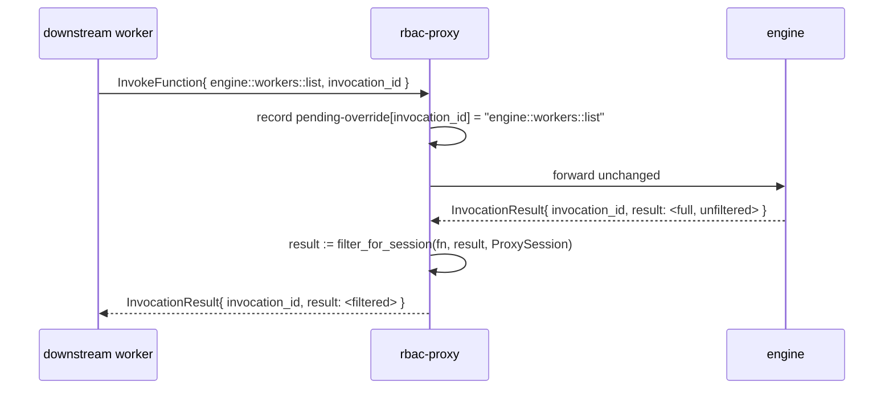

# Engine function overrides

This is the addition over the engine's RBAC contract. An engine RBAC listener
gates **invocation** of functions, but it filters the **discovery** surface by
an in-process `Session` that a remote proxy never has (see
[rbac.md § The proxy has no engine `Session`](rbac.md#the-proxy-has-no-engine-session)).
Six engine functions are **discovery surfaces**: `engine::functions::list/info`,
`engine::workers::list/info` and `engine::observers::list/get`. A gated worker
that *can* reach them (they are gated by `expose_functions` like any other
function — they are **not** in the carve-out) would otherwise *enumerate*
functions, workers and observers it can never call, including their schemas,
owners, host metadata and observer targets.

`rbac-proxy` closes that gap. It **result-filters the six discovery functions**
and rewrites their results to the caller's boundaries before they reach the
downstream worker, so discovery shows exactly the surface the caller is allowed
to invoke — nothing more. Two more engine functions are gated by the
interceptor instead: `engine::workers::register` is the session's own setup
call (carve-out, no result rewrite), and `engine::observers::dispose` is
forwarded only for an observer the connection created (the engine lets a
caller without a session dispose any observer).

## How the override works

The override does not replace the engine's implementation — the engine still
computes the answer. The proxy intercepts the **request** to record that this
`invocation_id` is an overridable `engine::*` call, lets the engine compute the
full result, then intercepts the **result** and filters it. Two kinds of rows
cannot be filtered from their own response alone — `engine::workers::list`
carries a `function_count` but no per-function ids, and an observer row names
its observed function and its target without their metadata — so the filter
also consults the proxy's [catalog cache](#catalog-cache) when a metadata filter
is configured:



The filter predicate is the **same vendored `is_function_allowed`** used on the
invocation path ([rbac.md § Access resolution](rbac.md#access-resolution-order)),
applied to every function id that appears anywhere in a discovery result. A
result entry survives iff the caller would be allowed to invoke the function it
refers to. This guarantees the discovery surface and the invocation surface can
never disagree.

## Per-function rewrite table

`A(id)` below means "`is_function_allowed(id)` against this connection's
`ProxySession`", in the namespace the row names — i.e. the access-resolution
decision flow. `strip(id)` removes the session's own `{prefix}::`
([Prefix in results](#prefix-in-results)). `own(o)` is true for an observer
this connection created.

| Function | Request | Result rewrite | Empty / denied policy |
|---|---|---|---|
| `engine::functions::list` | pass through | keep `functions[]` entries where `A(function_id)`; `strip` ids and worker names | return the (possibly empty) filtered list |
| `engine::functions::info` | pass through | if `!A(function_id)` → error; else `strip` ids (the row names no other function: `observer_count` is a count) | **`FORBIDDEN`** when `!A(function_id)` (engine parity — see note); `NOT_FOUND` when genuinely missing |
| `engine::workers::list` | pass through | resolve each worker's function set via the [catalog cache](#catalog-cache) (the response has only a `function_count`, no ids); drop workers with zero accessible functions; recompute `function_count`; strip worker-internal fields per [policy](#worker-internals-leak-policy) | filtered list |
| `engine::workers::info` | pass through | filter the nested `functions[]` (this response *does* carry them) to accessible ones; recompute `function_count`; strip worker-internal envelope fields. `observers[]` are opaque ids; `engine::observers::get` filters each one | `NOT_FOUND` when zero accessible functions |
| `engine::observers::list` | pass through | keep `observers[]` rows where `own(o)`, or `A(function_id)` and `A(target.function_id)`; `strip` both ids | filtered list |
| `engine::observers::get` | pass through | as one row of `engine::observers::list` | **`OBSERVER_NOT_FOUND`** when the row is hidden (engine parity: an observer the caller may not see does not exist for it) |
| `engine::observers::dispose` | forwarded only when `own(id)`; else `FORBIDDEN` | none | — |
| `engine::workers::register` | the session's own setup call (infra carve-out) | none (response is `{ success }`) | pass through; the proxy declares the worker as `rbac-proxy:<prefix>::<name>` (`rbac-proxy:<name>` without a prefix), so the engine's one live worker per name and its replacement of a suspended observer from a new connection of its worker (observe v2 decision 51) stay within one prefix, and every proxied worker's name starts with `rbac-proxy:` |

> **Denied-call error code (engine parity vs hardening).** The engine's
> `engine::functions::info` returns `FORBIDDEN` for a function the session may
> not see and `NOT_FOUND` only for one that does not exist
> (`engine_fn/mod.rs:1146-1164`) — so existence leaks via the code. The table
> defaults to **engine parity** (`FORBIDDEN` on denied) so the proxy matches a
> `worker-gateway` listener, and so the discovery deny code agrees with the
> invocation deny code in [rbac.md](rbac.md#access-resolution-order). A
> deployment that wants to *also* hide existence may opt into collapsing denied
> → `NOT_FOUND`; that is an **intentional divergence** and is listed in
> [rbac.md § Intentional divergences](rbac.md#intentional-divergences-from-the-engine).

Response shapes the proxy parses to do this (from
`engine/src/workers/engine_fn/mod.rs` and `engine/src/observer/builtins.rs`) —
the fields that leak and must be filtered:

```rust
// engine::functions::list
struct FunctionSummary { function_id, namespace, worker_name, description?, metadata?,
                         args_format?, private?, observable?, observer_count }
// engine::functions::info
struct FunctionDetail { function_id, namespace, worker_name, description?, request_schema?,
                        response_schema?, metadata?, args_format?, private?, observable?,
                        observer_count }
// engine::workers::list  — only a function_count, NO functions[] array
struct WorkerSummary { name?, description?, version?, id, runtime?, os?, status,
                       function_count, connected_at_ms, active_invocations, isolation?, ip_address? }
// engine::workers::info  — DOES nest the functions; observers are ids
struct WorkerInfoOutput { worker: WorkerDetailEnvelope, functions: Vec<FunctionSummary>,
                          observers: Vec<String> }
struct WorkerDetailEnvelope { /* WorkerSummary + */ pid?, internal, latest_metrics? }
// engine::observers::list → { observers: Vec<ObserverInfo> }; engine::observers::get → ObserverInfo
struct ObserverInfo { id, function_id, namespace, args, filters,
                      target: { function_id, namespace }, capture, on, deliver,
                      worker: { worker_id, worker_name? }, state, reason?, fires, dropped,
                      activation_failures, max_fires?, expires_in_ms?, max_in_flight, created_at_ms }
```

The asymmetry matters: `engine::workers::list` does **not** carry the function
ids needed to filter it, and observer rows carry no function metadata, so the
proxy cross-references its cache (next section). Only `engine::workers::info`
nests the per-function array directly.

## Worker-internals leak policy

`engine::workers::list` / `::info` carry operational identity that a tenant in a
multi-tenant deployment should not see: `pid`, `ip_address`, `isolation`,
`internal`, and `latest_metrics`. The proxy gates these behind a single config
knob:

- **`expose_worker_internals: false`** (default) — strip the operational fields
  before returning. They live on different structs: `WorkerSummary`
  (`engine::workers::list`) carries only `ip_address` and `isolation`;
  `WorkerDetailEnvelope` (`engine::workers::info`) adds `pid`, `internal`, and
  `latest_metrics`. Strip `ip_address` + `isolation` from `WorkerSummary`, and
  `ip_address` + `isolation` + `pid` + `internal` + `latest_metrics` from
  `WorkerDetailEnvelope`. The caller still sees `name`, `version`, `status`,
  `function_count` (recomputed), and `connected_at_ms`.
- **`expose_worker_internals: true`** — pass them through (single-tenant /
  operator-trusted deployments where the full picture is wanted).

A deployment that wants per-session granularity can instead key the decision off
`AuthResult.context` (e.g. `context.admin === true`) in a small policy hook; the
config knob is the simple default.

## Prefix in results

When a session has a `function_registration_prefix`, its **own** functions live
in the engine registry as `{prefix}::{id}` and surface that way in discovery
results (`engine::functions::list` would show `tenant1::foo`). The worker
registered them bare (`foo`) and must see them bare. So the proxy **strips its
own session prefix** from every id and worker name in a discovery result that
starts with `{prefix}::`:

- `function_id` / referenced `function_id` that start with `{prefix}::` → strip
  to the bare id the worker knows.
- A foreign function (another session's namespace, or an unprefixed global) is
  shown with its canonical id — it is not the caller's prefix and is not
  stripped.
- A proxied worker's name starts with `rbac-proxy:` and keeps the prefix: the
  session's own workers are listed as `rbac-proxy:<prefix>::<declared name>`,
  the name `engine::workers::info` takes.

This is symmetric with the dispatch-path strip in
[protocol-interception.md § Prefix resolution](protocol-interception.md#prefix-resolution):
the worker registers `foo`, the engine stores `tenant1::foo`, and on the way back
— whether as a dispatched invocation or a discovery result — the worker only ever
sees `foo`.

> **Multi-tenant leak caveat.** Stripping only the caller's *own* prefix means a
> **foreign** tenant's prefixed id can still surface through a **shared**
> (non-prefix-scoped) exposure. With `expose_functions: [{ metadata: { public:
> true } }]`, tenant 2's `tenant2::foo` carrying `public: true` passes `A` and is
> shown to tenant 1 as `tenant2::foo` — leaking tenant 2's prefix and existence.
> This is an accepted limitation of a shared expose list; a deployment that needs
> hard per-tenant isolation must scope each session's surface in the **auth
> function** (per-session `allowed_functions` / `forbidden_functions`, or a
> per-tenant `expose` policy) rather than relying on a global metadata filter.

## Catalog cache

Several rewrites need data the invocation/discovery frame does not carry. The
proxy maintains a small TTL cache over its **control connection**, keyed by
`(namespace, function_id)` with the **engine** id (prefixed where applicable,
since that is what discovery results and filters operate on):

- **Function catalog** (`function_id → { worker_name, metadata }`) from
  `engine::functions::list`. Needed for (a) **metadata** filters —
  `is_function_allowed` for `expose_functions: [{ metadata: { public: true } }]`
  needs the registered `metadata` of an observer row's function and target, and
  of a call's target; and (b) `engine::workers::list`, whose `WorkerSummary`
  carries a `function_count` but no ids — the proxy derives each worker's
  accessible-function set (hence the recomputed count and the
  drop-empty-workers rule) from this cache.

It is refreshed lazily on a short TTL (5 s) and proactively whenever
`engine::on-functions-changed` is called: the control connection observes it
with `rbac-proxy::on-functions-changed`, which invalidates the cache. Mirror
`console`'s function-list cache.

**Cache-miss semantics.** A miss is not uniformly fail-closed — it depends on
the filter kind:

- **Wildcard** filters (`match("api::*")`) need only the `function_id` string,
  never the catalog, so a never-before-seen `api::new` is correctly **allowed**
  on a cold cache. Do not over-fail-closed here.
- **Metadata** filters need the cached `metadata`, so a miss **fails closed** —
  a freshly-registered metadata-gated function is briefly invisible until the
  catalog refreshes, never wrongly exposed.

## Why not just patch the engine?

Making the discovery functions session-aware in the engine is the smaller
change *if* RBAC stays in-engine — and it is the right fix for `worker-gateway`.
But it does nothing for the out-of-process use case this spec targets: a proxy
fronting a **remote or managed** engine cannot patch that engine. Doing the
filtering in the proxy makes the discovery surface correct **regardless of the
engine version or who operates it** — the proxy only relies on the stable
`engine::*` request/response shapes, which are part of the SDK's public surface.
If the engine later gains full session-aware discovery, the proxy's overrides
become a redundant (but harmless) second layer that can be dropped per function.
