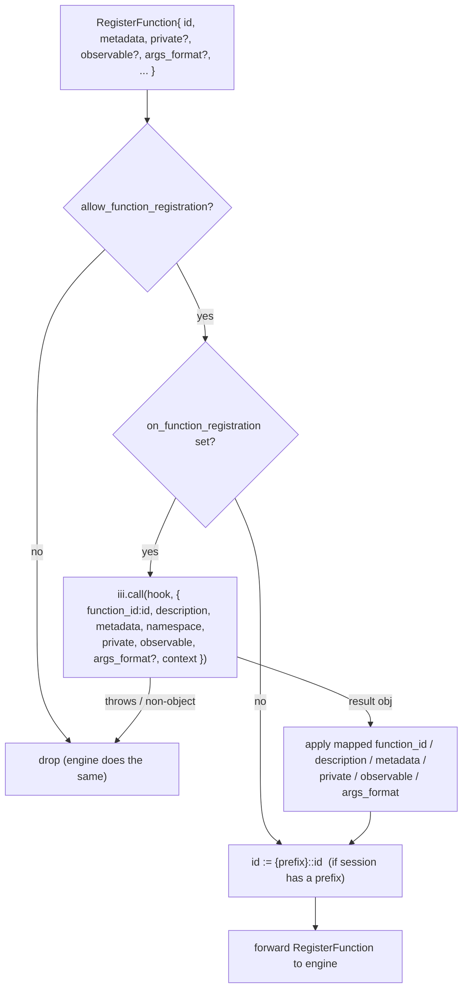
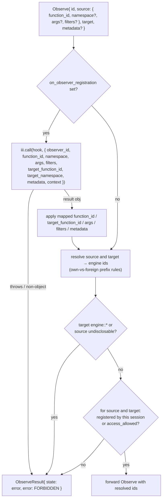
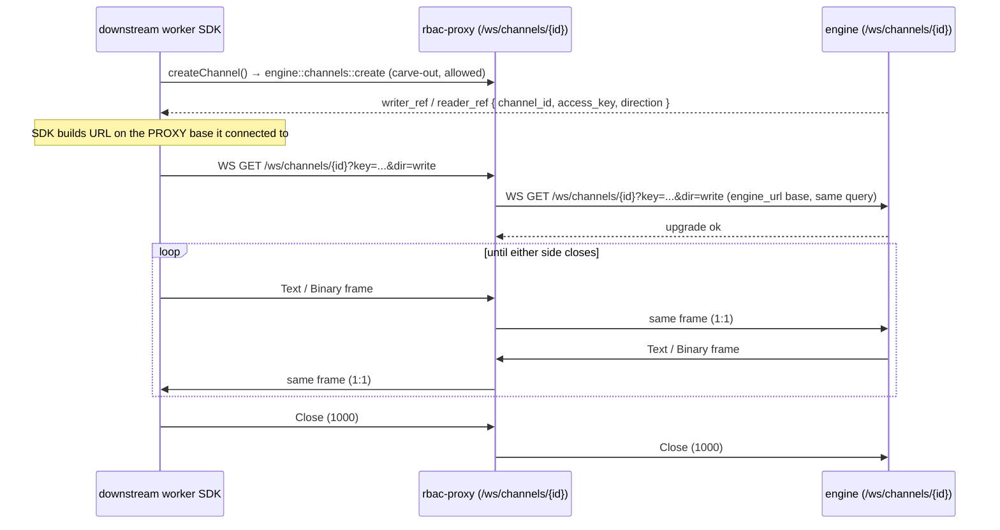

# Protocol & interception

The proxy speaks the iii worker WebSocket protocol verbatim
(`iii/engine/src/protocol.rs:40-126`). It does **not** invent a wire format — it
parses each JSON text frame, decides per message type whether to forward,
rewrite, or answer it, and re-serializes. This file is the reference for what
flows over the wire and what the proxy does to each frame.

The transport mechanics — one outbound engine WebSocket per inbound connection,
`axum::ws::Message` ↔ `tokio_tungstenite::Message` conversion, `tokio::select!`
on the two pump halves, close propagation — are the `console`
[`src/proxy.rs`](../../console/src/proxy.rs) pattern unchanged. The interceptor
is spliced into each pump half.

## Frame format

All protocol messages are WebSocket **Text** frames carrying a JSON object with
a `type` discriminant (lowercase). Binary frames are reserved for OpenTelemetry
(OTLP/MTRC/LOGS) and are forwarded untouched. The `Message` enum, as far as the
proxy reads it:

```rust
#[serde(tag = "type", rename_all = "lowercase")]
pub enum Message {
  RegisterFunction     { id, description?, request_format?, response_format?, metadata?, invocation?,
                         args_format?, private?, observable? },
  UnregisterFunction   { id },
  FunctionRegistered   { id, namespace, revision, local_dispatch, observers: [ObserverView] },
  RegistrationRejected { code, namespace, function_id?, owner_worker_id, worker_name? },
  InvokeFunction       { invocation_id: Option<Uuid>, function_id, data, namespace?, traceparent?, baggage?,
                         action?, metadata?, caller?, observe_depth?, activation?: { observer_id } },
  InvocationResult     { invocation_id: Uuid, function_id, result?, error?, observed?: [observer_id],
                         traceparent?, baggage? },
  Observe              { id, source: { function_id, namespace?, args?, filters?, capture?, on?, deliver? },
                         target: { function_id, namespace? }, metadata?, max_fires?, expires_in_ms?, max_in_flight? },
  Unobserve            { id },
  ObserveResult        { id, state, error?, warnings? },
  ObserverStateChanged { id, state, reason?, fires },
  ObserverAdded        { function_id, namespace, revision, observer: ObserverView },
  ObserverRemoved      { function_id, namespace, revision, id },
  ObserverAck          { function_id, namespace, id, revision, error? },
  InvocationsObserved  { items: [{ function_id, namespace, invocation_id, matched, status, input?,
                         output?, output_is_input?, error?, caller?, ... }] },
  LocalInvocationStats { window_ms, functions: [{ function_id, ... }], dropped_reports: [{ function_id, ... }] },
  RegisterService      { id, name, description?, parent_service_id? },
  Reattach             { token },
  Ping, Pong,
  WorkerRegistered     { worker_id, features?, reattach_token? },
}

// What a host sees of an observer of its function.
struct ObserverView { id, args, filters, target, capture, on }
```

Supporting shapes:

```rust
struct ErrorBody { code: String, message: String, stacktrace: Option<String> }

#[serde(tag = "type", rename_all = "lowercase")]
enum CallAction { Enqueue { queue: String }, Void }
```

- **Correlation** is by `invocation_id` (a UUID). `InvokeFunction` carries it
  (or `null` for `void`); the matching `InvocationResult` echoes it. The proxy
  **must preserve `invocation_id` byte-for-byte** through any rewrite, or the
  SDK's pending-call map never resolves.
- **Tracing.** `traceparent` / `baggage` (W3C Trace Context) ride both
  `InvokeFunction` and `InvocationResult`. The proxy forwards them untouched.
- **`WorkerRegistered { worker_id }`** is the engine's first frame on a new
  connection. The proxy forwards it downstream (the upstream connection's
  `worker_id` is the worker's identity), minus the protocol `features` it does
  not enforce (see [Observers](#observers)).
- **Removed frame types.** The five binding messages of SDKs before 0.26
  (`REMOVED_FRAMES` in `src/interceptor.rs`, the engine's `REMOVED_MESSAGES`)
  are not part of the protocol. The proxy drops them with one `warn` per
  connection and frame type, naming what replaces each, exactly as the engine
  does.

### The out-of-band rejection frame

There is one frame the engine emits that is **not** a `Message` enum variant: on
a failed RBAC handshake the engine sends a bare error object and then closes,
**before** any `WorkerRegistered` (`engine/mod.rs:1441-1459`):

```jsonc
{ "type": "error", "error": { "code": "AUTH_ERROR", "message": "..." } }
```

The proxy **must reproduce this exact shape and ordering** when its own auth
function rejects a connection: send the `error` text frame, then a WS Close, and
**never** open the upstream connection or send `WorkerRegistered`. SDK clients
already special-case this frame; diverging makes auth failures hang.

## Per-frame interception

The interceptor sits in both pump directions. The tables below give, for each
message type, the direction it travels and what the proxy does.

### Downstream → engine (frames the worker sends)

| Message | Proxy action |
|---|---|
| `RegisterFunction` | Check `allow_function_registration` → run the `on_function_registration` hook (map/deny) → apply `{prefix}::` to `id` → record the id as the session's own (and as private when `private: true`) → forward. See [Registration frames](#registration-frames). |
| `UnregisterFunction` | Its `id` **is** a function id, so re-apply `{prefix}::` to `id` (the engine prefixes it on registration via `resolve_registration_id`), forget the observers it hosted, then forward. |
| `Observe` | Run the `on_observer_registration` hook → resolve source and target (own-vs-foreign prefix rules) → refuse `engine::*` targets and sources the proxy cannot disclose → [verify access to both](rbac.md#observer-registration-rbac) → forward with the resolved ids, or reply `ObserveResult{ state: "error", error: FORBIDDEN }`. See [Observers](#observers). |
| `Unobserve` | Forward unchanged (the engine disposes only an observer the connection owns). |
| `ObserverAck` | Forward with `{prefix}::` applied to `function_id` when the connection registered that function; else drop. |
| `InvocationsObserved` | Per item: keep it only for a function the connection registered, under its engine id, with a `caller` the proxy vouches for; drop the frame when no item is left. |
| `LocalInvocationStats` | Keep the `functions` and `dropped_reports` entries of functions the connection registered, under their engine ids; drop the frame when none is left. |
| `InvokeFunction` with `activation.observer_id` | A call through an observer: forward as sent when the engine announced that observer to this connection as the host of its function; else reply `InvocationResult{ error: NOT_FUNCTION_OWNER }` (drop a `void` one, as the engine does). No middleware. |
| `InvokeFunction` (`engine::*` discovery) | Forward; record `invocation_id → function_id` in the pending-override map so the matching result is rewritten. See [engine-overrides.md](engine-overrides.md). |
| `InvokeFunction` (`engine::observers::dispose`) | Forward only for an observer this connection created; else `FORBIDDEN`. |
| `InvokeFunction` (`engine::*` carve-out, e.g. `engine::channels::create`) | Allowed by carve-out → forward unchanged. A queued `engine::*` call is refused: it would run later as the queue worker. |
| `InvokeFunction` (other) | [Access resolution](rbac.md#access-resolution-order): deny → synthesize `InvocationResult{error: FORBIDDEN}` (matching the engine, which replies even for a `void` action — fabricate an `invocation_id` when it is `null`; the worker simply has no pending entry for it); allow + the session's own private function → forward (the middleware runs on the control connection, which a private function refuses); allow + middleware set → invoke middleware on the control connection, reply with its result; allow + no middleware → resolve [prefix](#prefix-resolution) → forward. |
| `InvokeFunction` (`engine::workers::register`) | Carve-out. When the auth result scopes the session to namespaces, the declared `data.namespace` (absent = `default`) must be one of them, else the engine's refusal is reproduced: the call's `FORBIDDEN` result, `RegistrationRejected{ code: NAMESPACE_FORBIDDEN }`, then Close. The declared namespace is recorded (an id is the session's own only in it), `data.name` becomes `rbac-proxy:<prefix>::<name>` (`rbac-proxy:<name>` without a `function_registration_prefix`; see [Observers](#observers)), and `data.features` is reduced to what the proxy enforces. |
| `InvocationResult` (worker answering a dispatched call) | Forward; correlation is by `invocation_id`, so the (bare) `function_id` is informational and passes through, and so do `observed` and the result (the engine checks every observer id). |
| `RegisterService` | Forward unchanged (engine-internal service discovery; not gated). |
| `Reattach` | Forward unchanged (carries the connection's own token). |
| `Ping` / `Pong` | Forward unchanged. |
| a removed frame type | Dropped, with one `warn` per connection and type. |
| anything else | Dropped. |

Every `InvokeFunction` is gated in the namespace it names (`namespace`, absent =
`default`); a non-string `namespace` is dropped, as the engine cannot decode
it. An `Observe`'s source and target are each checked in the `namespace` they
name the same way.

On every call and report, `caller` (the SDK's claim about the call chain,
which observers read and filter on) is kept only when it names a call the
engine routed to this connection that it has not answered yet, and the proxy
then writes it from that call: its `function_id` and `invocation_id`, and that
call's own caller as `parent`. Anything else loses its `caller`.
`observe_depth` passes as sent. Report items are local calls of the reporting
connection: a routed call's matches travel on its answer's `observed`, and the
engine drops an item for a call it routed to the connection.

### Engine → downstream (frames the engine sends)

| Message | Proxy action |
|---|---|
| `WorkerRegistered` | Reduce `features` to what the proxy enforces → forward. |
| `RegistrationRejected` | The id stops being the session's own; strip `{prefix}::` from `function_id` → forward. |
| `FunctionRegistered` | Record its observers as the ones this connection hosts; strip `{prefix}::` from `id` and from each `observers[].target`; set `local_dispatch: false` when middleware is configured, unless this connection registered the function `private: true` in its namespace → forward. |
| `ObserverAdded` / `ObserverRemoved` | Add or remove the observer among the ones this connection hosts; strip `{prefix}::` from `function_id` (and `observer.target`) → forward. |
| `ObserveResult` / `ObserverStateChanged` | Track the observers this connection created (accepted until `error` or `disposed`) → forward. |
| `InvokeFunction` (engine dispatching a call **to** the worker) | Remember the call until the worker answers it (what a `caller` must name) → strip `{prefix}::` from `function_id` so the worker SDK finds its local handler; for an activation of an observer this connection created that delivers the `Observed` envelope, strip it from `data.function_id` too → forward. Middleware does **not** apply to inbound dispatch. |
| `InvocationResult` (result of a call the worker made) | If `invocation_id` is in the pending-override map → rewrite `result` per [engine-overrides.md](engine-overrides.md) and drop the map entry → forward; else forward unchanged. |
| `error` | Forward unchanged. |
| `Ping` / `Pong` | Forward unchanged. |
| anything else | Dropped. |

**Unknown frame types are dropped, in both directions.** The engine behind the
proxy has no RBAC session for the proxied connection, so it gates nothing: a
frame type the proxy has not learned is a frame nobody gates. A protocol
addition therefore stays closed through the proxy until the proxy learns it,
rather than reaching the engine unchecked. Frames that are not JSON, or carry
no `type`, are dropped too (the engine drops them anyway).

### Observers

Observers are negotiated per connection with protocol `features`. The engine
runs them for a proxied connection with no RBAC session, so the proxy gates
them from both sides.

- **Features.** `data.features` of `engine::workers::register` and `features`
  of `WorkerRegistered` keep `observe.v1`, `observe.v2` and
  `local-dispatch.v1`. With `middleware_function_id` set, a
  `FunctionRegistered` reaches the worker with `local_dispatch: false` unless
  the connection registered the function `private: true` (observe v2
  decision 46). An in-process call never reaches the middleware, so the SDK
  routes its own calls of every other function through the engine and the
  proxy; its own calls of a private function skip the middleware on either
  path. `large-messages.v1` is removed: the proxy forwards text frames only.
- **Observing.** An `Observe` is gated like a call of both functions it names
  (see the flowchart below and [rbac.md § Observer registration RBAC](rbac.md#observer-registration-rbac)).
  On top of the engine's checks, the proxy refuses an `engine::*` target, since
  an observer's target runs with no session behind it, and these sources,
  whose calls carry what the session's discovery view hides: the
  infrastructure carve-out, the discovery functions, `engine::observers::*`,
  `engine::on-functions-changed`, `engine::on-workers-changed` and
  `engine::on-observers-changed`.
- **Hosting.** The frames a host exchanges about the observers of its
  functions pass for the functions the connection registered, with the
  session prefix rewritten both ways: `FunctionRegistered`, `ObserverAdded`,
  `ObserverRemoved` toward the worker; `ObserverAck`, `InvocationsObserved`,
  `LocalInvocationStats` toward the engine. `output_is_input` on report items
  and `observed` on results pass as sent.
- **Calls through observers.** An `InvokeFunction` with
  `activation.observer_id` passes only for an observer the engine announced to
  this connection (in `FunctionRegistered` or `ObserverAdded`, until
  `ObserverRemoved`). The engine checks the rest: that the sender hosts the
  observed function, that the observer is active, and its policy.
- **Back on a new connection.** An `Observe` that names the id of a
  suspended observer replaces it when the engine knows both connections
  under one worker name in one namespace (observe v2 decision 51), and is
  refused with `OBSERVER_ID_CONFLICT` otherwise, until the grace period ends.
  The proxy declares a session's worker as `rbac-proxy:<prefix>::<name>`, so
  the replacement, like the engine's one live worker per name, stays within
  the sessions of one `function_registration_prefix`: a restarted worker
  takes its observers back (a queue consumer keeps its backlog by observer
  id), and a session under another prefix is another worker. A session
  without a prefix is declared as `rbac-proxy:<name>`; as with its function
  ids, nothing scopes its names (a declared `tenant1::queue` is tenant1's
  `queue`).
- **Registrations.** `private`, `observable` and `args_format` on
  `RegisterFunction` pass to the engine and to the `on_function_registration`
  hook, whose answer may replace them. A 0.25 `observe` object passes as sent;
  the engine reads `allow: false` as `observable: false` and refuses
  `delivery: owner`.
- **Discovery.** `engine::observers::list` and `engine::observers::get` are
  [discovery overrides](engine-overrides.md); `engine::observers::dispose`
  reaches only the observers this connection created.

The vendored wire fixtures (`rbac-proxy/tests/fixtures/protocol/observe/`) pin
each case.

## Registration frames

`RegisterFunction` is gated by `allow_function_registration` and the
`on_function_registration` hook, then prefixed:



`Observe` runs the `on_observer_registration` hook, then resolves both ids and
verifies the session may call each (see
[rbac.md § Observer registration RBAC](rbac.md#observer-registration-rbac)).
On denial the proxy answers as the engine does,
`ObserveResult{ state: "error", error: { code: "FORBIDDEN", message } }`.



> **Hook input note — ordering.** The hooks see **bare** ids, *before* prefix
> resolution or the access check: the engine calls the hook with the
> worker-supplied ids, applies the hook's optional mapping, and only then
> resolves the engine ids. So the proxy order for `RegisterFunction` is **bare
> id → hook → apply `{prefix}::{id}` → forward**. For `Observe` it is **bare
> ids → hook → apply mapped ids → resolve source and target (own-vs-foreign) →
> access check → forward** — see the flowchart above.
> (The engine's own `iii-worker-manager` README states "after
> `function_registration_prefix`", which is a **doc bug** — the code applies the
> prefix after the hook, not before. The proxy follows the code.)

## Prefix resolution

The prefix is a private namespace for the **session's own** registrations
(see [rbac.md § Function registration prefix](rbac.md#function-registration-prefix)).
That creates one subtlety on the invocation path: when a prefixed session invokes
a function, is the target one of its own (registered bare, stored prefixed) or a
foreign function (canonical id)?

The proxy resolves it deterministically against the set of ids the session has
registered on this connection (it sees every `RegisterFunction`, so it knows
them). An `Observe` resolves its source and its target the same way:

```
on InvokeFunction{ function_id: F } from a session with prefix P:
  let candidate = "{P}::{F}"
  if the session registered candidate  -> target := candidate   (own function)
  else                                  -> target := F           (foreign function)
  run access-resolution against target  (the id as it exists in the engine)
  forward InvokeFunction with function_id := target
```

`expose_functions` / `forbidden` / `allowed` therefore match against the id **as
it exists in the engine registry** (foreign ids are canonical; own ids are
prefixed). This keeps wildcard patterns matching the right strings.

> **This is an intentional improvement over the engine, not parity — call it out
> as such.** The engine applies `function_registration_prefix` *only* on
> registration and inbound dispatch; its `InvokeFunction` handler uses the raw
> `function_id` verbatim (`engine/mod.rs` invoke path), so a prefixed worker that
> registered bare `foo` and then invokes bare `foo` gets `NOT_FOUND` on a real
> engine — the engine's transparent prefix is one-directional. The proxy's
> own-vs-foreign resolution above lets a prefixed session call its own bare-named
> function, which the engine does not. It is the right behaviour (a worker should
> be able to call what it registered), but because it diverges from a
> `worker-gateway` listener it is listed in
> [rbac.md § Intentional divergences](rbac.md#intentional-divergences-from-the-engine).
> A deployment that wants strict engine parity instead can disable own-id
> re-prefixing and accept that prefixed workers cannot self-invoke by bare name.
>
> Either way this is the single subtlety the implementation must test explicitly:
> a session calling its own `foo` (registered bare, stored `tenant1::foo`) and the
> same session calling a foreign `api::users::list` (matched against
> `expose_functions` unprefixed) — both covered by the unit tests in
> [rbac-proxy.md § Testing](rbac-proxy.md#testing).

## Channel bridge

A `StreamChannelRef` is `{ channel_id, access_key, direction }` and **carries no
host** (`sdk/.../channels.ts`, `protocol.rs:206-211`). The SDK builds the channel
URL from the address the worker connected to:

```
{engine_ws_base}/ws/channels/{channel_id}?key={url-encoded access_key}&dir={read|write}
```

Because a downstream worker connected to the **proxy's** port, its SDK dials
`/ws/channels/{id}` on the **proxy's** port. So the proxy must serve that route
and bridge it to the engine — and ref rewriting is neither needed nor possible
(there is no host in the ref to rewrite). This is **Pattern A**: mount and
bridge.



Bridge contract:

- The proxy mounts `GET /ws/channels/{channel_id}` on its RBAC port (alongside
  the `/` worker-protocol route), passing the `?key=` and `?dir=` query string
  through verbatim to `{engine_url}/ws/channels/{channel_id}`.
- Frames relay 1:1 in both directions: **Text↔Text, Binary↔Binary, Close↔Close**
  (preserving close code/reason), `Ping`/`Pong` pass through. This is the exact
  `axum_to_tungstenite` / `tungstenite_to_axum` conversion `console` already
  uses.
- **No auth function on the channel socket.** Channel access is independently
  validated by the engine against the `access_key` capability token (the engine
  returns 404 before upgrade on a bad key). The proxy does not re-authenticate
  the channel socket — it relays. The connection that *created* the channel was
  already authenticated on the worker-protocol port; the `access_key` is the
  capability for the data socket. (A deployment that wants to additionally bind
  channel sockets to the originating session can do so in the bridge, but it is
  not required for parity with the engine.)
- **Failure to dial the engine channel** → close the downstream channel socket
  with code `1011` (`internal error`), mirroring `console`'s dial-failure
  handling.

> **Backpressure / TTL.** The proxy bridge holds no buffer of its own beyond the
> socket — backpressure rides the WebSocket. Channel lifetime/TTL and the
> `mpsc` buffer remain the engine's `ChannelManager` concern; the proxy is a
> dumb relay. An idle channel that neither side connects expires in the engine
> (5-minute TTL) exactly as today.
