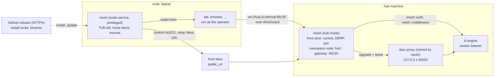

# Mesh Worker

One iii engine, many machines. `mesh` puts a person's other computers (a Linux
GPU box, a Mac, a Windows PC) on a private WireGuard network that the engine's
machine coordinates, and runs ordinary iii workers on each of them, so an agent
calls `laptop::shell::exec` or `gpu::coder::read-file` the way it calls
`shell::exec` today. The worker contract is in [mesh.md](mesh.md).

## Why

Every worker today acts on the engine's machine or inside a sandbox:

- `ide` runs `shell::*` and `coder::*` on its own host only, or in a microVM
  (`ide/src/target.rs`). It has no notion of another machine.
- `computer`'s remote mode drives a remote desktop, and its README says a
  remote machine needs its own executor for commands.
- `tailscale` drives the user's own tailnet through the `tailscale` CLI. It
  needs a Tailscale account, and the tailnet holds every device the person
  owns, not just the ones iii should reach.
- `bridge` joins two engines, not machines, and has no auth.
- A worker on another machine can connect with `III_URL`. The engine's worker
  listener has one optional `rbac` block, but it gates every connection on
  that listener, local workers included. No worker uses it today, and its
  host defaults to `0.0.0.0`.

Mainplane (MIT, Go) ships the missing shape: one command and an 8-character
device code make any machine a member of a private mesh. The mesh needs no
third-party account and no inbound port, keeps machines isolated unless
linked, and shares directories across machines. `mesh` brings that to iii,
then hands the machines to the bus instead of to a separate agent harness.

## Goals

1. **Join with one command.** A Linux, macOS or Windows machine joins with a
   one-liner and a short device code that the hub shows. No account, no
   inbound port on the node, no Tailscale needed.
2. **Private WireGuard mesh coordinated by the hub.** Paths are direct when the
   NATs allow it and go through the hub's relay otherwise. The mesh runs
   beside the user's own Tailscale without touching it.
3. **Isolation by default.** The hub reaches every node, and every node
   reaches the hub. Two nodes reach each other only when the config links
   them.
4. **Existing workers, remote.** Any iii worker built for the node's OS runs on
   the node, on the same bus, under the node's prefix: `laptop::shell::exec`,
   `laptop::coder::read-file`, `gpu::browser::...`. Those workers need no
   change.
5. **Shared drives.** One directory with one copy, mounted on many nodes.
6. **Removal in seconds.** A removed machine cannot undo its removal, even if
   it kept its state and the code it joined with.
7. **Usable by agents and people.** Agents discover and use machines through a
   skill. People use functions, and a Console page in phase 2.

## Non-goals

- Replacing the `tailscale` worker or managing a user's tailnet.
- Exit nodes, subnet routes, MagicDNS or any DNS change, Tailscale SSH,
  Taildrop, Funnel, OIDC login, or an ACL language. Links are the whole
  policy.
- More than one hub per mesh, federation between hubs, or meshes shared
  between people.
- A hosted rendezvous service. The hub needs a stable URL (see
  [mesh.md § Front door](mesh.md#front-door)).
- Provisioning cloud machines.
- New exec or file primitives in `mesh`. Nodes run `ide`, `browser`,
  `computer`, `tmux`, and the other existing workers for that.
- Drive servers on macOS or Windows.
- Sharing the project's `rbac-proxy` with other tenants. In v1, `mesh` owns
  it (see [mesh.md § Gateway](mesh.md#gateway)).

## Anti-goals

Any of these makes `mesh` a failure even if everything else works:

- `mesh` making the engine, or the proxy, reachable from the mesh or the front
  door. Only the gateway faces the mesh.
- A node escaping its grants:
  - registering a function or trigger type outside its own `<node>::` prefix;
  - binding a trigger type it was not granted;
  - seeing or rewriting hub calls through a harness hook;
  - reading another worker's configuration, or the hub's environment through
    a configuration template;
  - keeping a grant after the grant changes.
- An agent driving a node's supervisor or drives, or `mesh`'s middleware, by
  any path, `fp::pipe` and `fp::batch` included.
- Workers on a node running as root or admin.
- Anything a node runs as root that was fetched over plain HTTP.
- Any phone-home: no Tailscale log upload, no Tailscale DERP, STUN or DNS
  fallback servers, no telemetry.
- Breaking the user's Tailscale, their DNS, or any hosts-file line that `mesh`
  did not write.
- A device code that can be tested offline, or guessed more than 10 times per
  address per 10 minutes.

## Architecture

- **Hub** is `mesh` running as an ordinary worker beside the engine. It runs:
  - the coordinator: the Tailscale control protocol, trimmed from headscale
    the way Mainplane trims it;
  - the DERP relay;
  - the device-code join.

  It joins its own mesh as a userspace node named `hub`, with no root, and
  listens on that node for worker connections. It serves nothing executable.
- **Node** is the same binary installed as a system service on another
  machine. It owns a TUN interface, a hosts-file block and the drive mounts,
  and it supervises the iii workers configured for that machine. Those
  workers run as the person who installed the node and dial
  `ws://hub.iii.internal:49135` across the mesh.
- **Gateway.** The hub accepts a connection only from the mesh and learns
  which node it came from from WireGuard itself (the peer's address is bound
  to its key). It forwards the connection to the project's `rbac-proxy` with
  a one-time ticket. The proxy asks `mesh::auth`, which returns that node's
  grants:
  - everything the node registers is prefixed with `<node>::`;
  - the node may call only its allow list, through `mesh::middleware`, which
    keeps hub environment values out of its configuration reads;
  - it may bind only granted trigger types whose deliveries stay confined to
    the node, never the harness hooks.

  A change to the grants closes and re-authenticates the node's sessions.
  The hub drives each node's supervisor with requests signed by its identity
  key, so no agent can drive it.

  Nodes hold no engine credential: membership in the mesh is the credential.

## Lifecycles

### Join

1. The operator adds `mesh` and `rbac-proxy` to the project and sets
   `public_url`. On first boot the hub:
   - generates its identity key, control key, relay key, a random IPv6 ULA
     /48 and a device code;
   - takes ownership of the `rbac-proxy` config (see
     [mesh.md § Gateway](mesh.md#gateway));
   - opens the front door.
2. `mesh::join::code` returns the code and two one-liners. Each fetches the
   install script for the hub's own `mesh` release from GitHub over HTTPS and
   passes it `<public_url>` and the code. One is for sh, one for PowerShell.
3. The script downloads the `mesh` binary for the machine's OS and
   architecture from the same release, checks its sha256, and runs
   `mesh join <public_url> <code>` elevated (sudo or UAC asks once).
4. The node and hub run CPace over `POST /join`, bound to the hub's identity
   key, and the hub answers with the join secret, sealed under the shared key.
   - **A wrong code** learns nothing and costs one try from that address.
   - **A man in the middle** of a plain-HTTP `public_url` does not know the
     code either, so it gets one guess and cannot impersonate the hub.
   - **After joining**, the node pins the hub's identity key and trusts the
     control key only as signed by it (`GET /id`).
5. The node registers over `/ts2021` with the join secret. It gets a name (its
   sanitized hostname, made unique) and an address. It then installs itself
   as a service, brings up its TUN and hosts block, and long-polls its map.
6. The node service connects to the gateway as an iii worker. Its
   `mesh-node::*` functions appear as `<node>::mesh-node::*`. The hub updates
   the node to its own version if they differ, then applies that node's
   configured workers and drives.
7. The workers start and their functions appear as `<node>::...` in
   `engine::functions::list`. From phase 3, `mesh::node-changed` fires
   `joined`, then `online`.

### A call

An agent calls `laptop::shell::exec`. The engine routes it to the proxy
session that registered that id. The proxy strips the prefix, and the call
crosses the gateway connection and WireGuard to `ide` on the laptop. The
result returns the same way. A node that is offline has no session, so its
functions are absent, not failing.

The harness never puts its own filesystem scope on a remote call: the hub's
paths mean nothing on the laptop. It strips any scope the model wrote, so the
laptop's `ide` applies its own configured roots (see
[mesh.md § Required changes](mesh.md#required-changes-outside-mesh)).

### Gateway identity

1. The hub's userspace node accepts a TCP connection on `gateway_port`.
2. It looks up the peer address in its own map (WhoIs) to get the node name.
3. It mints a ticket: 32 random bytes, single use, valid for 10 s.
4. It opens the upstream WebSocket to the proxy. The upgrade carries
   `x-iii-mesh-ticket`, and any copy of that header the client sent is
   removed first.
5. The proxy calls `mesh::auth` with the headers. `mesh::auth` consumes the
   ticket and returns the grants for that node.

A missing, used or expired ticket is refused. A process on the hub's loopback
that dials the proxy directly therefore gets nothing.

### Removal

1. `mesh::nodes::remove` deletes the node, adds its keys to the refused list,
   cycles the device code, and (phase 3) revokes the join token that created
   the node. Join secrets derive from the code, and tokens are single use
   unless they are reusable and ephemeral. So a removed machine that kept its
   code, token and state still cannot register new keys.
2. Map deltas drop it from every peer within seconds.
3. The gateway closes its connections, so its functions leave the engine, and
   `node-changed` fires `removed`.
4. The node, on losing its registration, takes down its TUN, its hosts block,
   its mounts and its workers.

The cycled code means one-liners handed out before the removal stop working,
and `mesh::nodes::remove` returns the new code. The machine comes back only
through `mesh leave` and a fresh join.

### Links and drives

- **Links:** a change to `links` becomes a map delta.
- **Drives:** a change to `drives` becomes `<node>::mesh-node::drives::apply`
  on every node it touches.

Neither change needs a restart.

## Phases

| Phase | Ships | Acceptance ([mesh.md § Acceptance](mesh.md#acceptance-criteria)) |
| --- | --- | --- |
| 1. Core | Tailscale fork; coordinator, relay, device-code join; Linux and macOS nodes (service, TUN, hosts, self-update); links; removal; `mesh::status` / `nodes::*` / `join::*`; gateway with `rbac-proxy`; node supervisor running `ide`; skill; [required changes](mesh.md#required-changes-outside-mesh) in harness, fp, rbac-proxy and configuration | 1–7, 9, 10 |
| 2. Reach | Windows nodes (wintun, service, hosts), drives (NFS and SMB), Console page | 8, and 1–6 on Windows 11 |
| 3. Automation | Join tokens and ephemeral nodes, `mesh::node-changed`, `browser` / `computer` / `tmux` on nodes | 11 |

## Alternatives considered

- **Ride the user's tailnet.** The gateway would listen on the Tailscale
  address and use Tailscale's WhoIs, which removes the fork, the coordinator
  and the TUN code. It was rejected as the primary design because it needs a
  Tailscale account, exposes every device in the tailnet, and gives no
  per-iii isolation. It stays cheap to add later: the gateway, supervisor and
  drives need only a WhoIs lookup from the network beneath them.
- **The engine's own `rbac` block instead of `rbac-proxy`.** It sits on the
  engine's single worker listener, so turning it on gates every local worker
  as well. `mesh` itself would then have to authenticate through
  `mesh::auth`, an auth function that does not exist until `mesh` connects.
  `rbac-proxy` gives the mesh its own door and leaves local workers alone.
- **Expose the engine (or `rbac-proxy`) to the internet with tokens.** This
  gives no NAT traversal, no machine-to-machine links and no drives, and it
  puts a long-lived credential on every machine.
- **Write the WireGuard layer from scratch.** Rejected: Mainplane's is ~4.1k
  lines, MIT, and already handles the Windows adapter, the MSS clamp and IPv6
  fragmentation on real hardware. That count is the network and drive code;
  service install adds ~0.8k. Port it.

## Spec index

| Document | Covers |
| --- | --- |
| [mesh.md](mesh.md) | The worker: modes, code reuse, front door, config, state, join, node, gateway, drives, functions, agent exposure, required changes outside `mesh`, boundaries, dependencies, testing, acceptance |

## Prior art

- **Mainplane** (`github.com/mainplane-ai/mainplane`, MIT, Go):
  - `pkg/mesh`: TUN, router, hosts block, MSS clamp, fragmenter.
  - `pkg/coordinator`: from headscale's `hscontrol`, BSD-3, plus drive
    coordination.
  - `pkg/auth/code.go`: the CPace device code, via `filippo.io/cpace`.
  - `pkg/elevate`, `pkg/worker/drives_*` and `pkg/worker/install_*`.
  - The fork `mainplane-ai/tailscale v1.102.4-mainplane.8`.
  - `docs/self-hosting.md`: the mesh and drive behaviour this spec follows.
- **headscale**: the control protocol server Mainplane's coordinator trims.
- **Tailscale** `tsnet`, `derpserver`, `wgengine`: the network stack.
- **This repo**: `rbac-proxy` (auth function, registration prefix,
  middleware, filtered discovery), `ide`'s per-call `target`, `computer`'s
  remote driver, and `docs/sops/go-binary-worker.md`.
